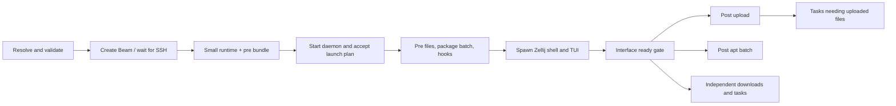

# Configurable Beam launches

Status: offline compiler, phase archive packing/verification, foreground
execution, daemon launch acceptance/snapshots and `beams ssh` profile
launches implemented; the legacy startup is removed, 2026-11-07. The supported profile syntax
and explicit pack/unpack/run commands are documented in the
[developer guide](../development/launches.md). Overlay visibility and
`config init` remain planned. Sections below that describe the old fixed
startup, `bin/beam-shell` or `[startup]` are the design's starting point,
kept for context; none of that code exists any more. This design
builds on [DESIGN.md](DESIGN.md)'s task graph and
[CLIENT_SERVICES_DESIGN.md](CLIENT_SERVICES_DESIGN.md)'s workstation-owned
transport. [TODO.md](../../TODO.md)
tracks the implementation sequence.

The overall plan, graph direction, explicit readiness conditions, and
developer documentation requirement were endorsed on 2026-11-06. The
remaining daemon/launcher/transport details are proposed; the implementation
boundary and handoff below identify what is available today. The compiler
establishes strict schema v1, local inheritance, named file/script/custom-
template definitions, package batches, artifact selections and graph validation.

## Implementation status and next-session handoff

Updated 2026-11-07 after the legacy-startup removal (`a7f32d2`), which
followed the `beams ssh --profile` slice (phase 3 of the sequence below).
A new Beam can now be created for a launch: the
workstation packs the profile first, copies a small runtime and the pre
bundle (no Git checkout), and the Beam runs pre, opens a per-launch Zellij
session and reports readiness; post goes over the bridge as with `beams
config launch`. Since the legacy removal (same day) every `beams ssh`
Beam is a launch: `--profile`, `[launch] profile`, else
`builtin:development`.

| Commit | Completed milestone | Main implementation |
|---|---|---|
| `38109e3` | Fresh-checkout repair; preserve Beam-managed SSH state, link only `bin` | `bootstrap/src/steps/link.rs` |
| `2462cbb` | Strict schema v1, inheritance/provenance, offline validation/explanation, sanitized embedded starters and team fixture | `client/src/config/`, `environments/`, `protocol/src/task_catalog.rs` |
| `6595f3d` | Launch UUID/plan digest, deterministic phase-local tar/gzip snapshots, deferred post packing, frozen replay and verified atomic read-only staging | `protocol/src/launch.rs`, `artifacts/`, `client/src/config/pack.rs` |
| `0853c81` | Generic package/file/hook adapters, foreground phase execution, hook retry/history, Rust's apt split and manifest acceptance-order repair | `bootstrap/src/launch/`, `packages.rs`, `commandlog.rs`, `daemon.rs` |
| `090236d` | Runner takes shared executor resources and a `Conditions` policy; reusable `verify_phase` | `bootstrap/src/launch/runner.rs` |
| `e36c9f2` + CLI commit | Daemon acceptance by UUID/digest, waiting conditions, snapshots with a `seq` boundary, restart → interrupted, explicit retry; `launch submit/signal/status/retry`; hooks get the relay socket | `bootstrap/src/launch/daemon.rs`, `launch/mod.rs`, `daemon.rs` |
| `e8b571c` | Shell/TUI readiness gate; Beam TUI loads launch snapshots on connect and on acceptance | `launch/daemon.rs`, `tui/app.rs`, `shell/fish/conf.d/beams-launch.fish` |
| `6cff233` | `launch` bridge capability: chunked resumable uploads, submission by ID/digest, owner-routed status/conditions; the Beam stages each bundle itself (`launch receive`) | `protocol/src/lib.rs`, `launch/upload.rs`, `launch/daemon.rs` |
| `59cdd45` | Workstation driver and `beams config launch`; bridge writer stops polling | `client/src/clientd/launches.rs`, `client/src/config/mod.rs`, `client/src/bridge.rs` |
| (2026-11-07) | `beams ssh --profile`/`--push-repo`, `[launch] profile`; `~/.beams/` runtime staging; `launch start`/`launch shell`; per-launch Zellij session; bridge adopts a Beam-submitted launch; launch Beams skip `[startup]`; plan PATH `~` expansion | `client/src/main.rs`, `stage.rs`, `bridge.rs`, `clientd.rs`, `bootstrap/src/launch/session.rs`, `launch/daemon.rs`, `shell/runtime/` |
| `52c0363`, `c75b48c` | `KnownHostsCommand` through the workstation; launch `[ssh_grant]` | `bootstrap/src/knownhosts.rs`, `client/src/knownhosts.rs`, `client/src/config/plan.rs`, `client/src/clientd/launches.rs` |
| `1c9f0e7`, `a967019` | starship as a pre template in `builtin:development`; `beams` on the session `PATH` | `bootstrap/src/tasks/install_starship.rs`, `launch/session.rs` |
| `fe7556c`, `a7f32d2` | Legacy removal: profile always, no `[startup]`/`RunManifest`, no fixed steps, `bin/`, `shell/fish`, `shell/zellij` | `client/src/main.rs`, `clientd.rs`, `protocol/src/lib.rs`, `bootstrap/src/main.rs`, `bootstrap/src/install/` |

Available commands are `beams config validate/explain/pack/pack-post/launch`,
`beams ssh --profile`, and `beam-bootstrap launch
unpack/run-phase/submit/signal/ready/receive/status/retry/start/shell/install-packages`.
The [developer guide](../development/launches.md#launch-a-new-beam-beams-ssh---profile)
documents the `ssh --profile` flow, the daemon path, readiness, the bridge
flow, ops, events and the snapshot boundary; the binary READMEs document
flags.

### Current execution boundary

- `beams ssh` packs, creates the Beam, copies `~/.beams/`
  (runtime + launch) with one `tsh beams scp`, registers the launch with
  the local daemon before its bridge, and runs `launch start`. That starts
  the daemon via `beamctl` from the runtime binary, submits locally (no
  owner), receives pre, installs Zellij alongside pre, and execs Zellij
  in `beams-<alias>` (the Beam's own `$BEAM_ALIAS`, e.g. `beams-brave-
  ping`; falls back to `beams-<id prefix>` without one). The bridge's
  resubmission adopts the launch as owner, so `interface-ready` reaches
  the workstation, which packs and uploads post.
- Readiness: every pane's shell starts via `beams-shell` → `launch shell`
  (reports `shell`, execs `$BEAMS_SHELL`); the TUI reports `tui`.
  `config launch` onto an existing Beam has no shell reporter (the fish
  conf.d hook is gone): use `--headless` or `launch ready`.
- Reuse records the launch in the purpose entry and reruns `launch
  start`, which reattaches. A different profile is refused; a tracked
  Beam with no launch isn't reused, and `--beam` refuses one. The
  maintainer's clones, grant and old fixed steps (claude update/CLAUDE.md
  merge, kubectl, tbot/tctl from the staging CDN, k3s bot) are a
  gitignored local profile (`environments/local/personal.toml` +
  `personal/` hooks).
- Unchanged from before: bridge uploads are bounded by an 8 × 32 KiB
  window; no cancel op and no cleanup of finished launches; retry is
  Beam-side only; owned-subprocess reconciliation is missing. The session
  overlay doesn't show launches yet.

### Next implementation slice

1. **Visibility.** Launch status and upload progress in the session
   overlay (`ServerEvent::LaunchChanged`), retry over the bridge.
2. **Legacy-removal follow-ups.** Done: maintainer profile, real-key
   grant clones (3 of 5 uses on `radiant-rocket`), removal. First, on the
   workstation: move any `[startup]` out of `config.toml` (now refused),
   install the maintainer profile (below) and set `[launch] profile`, and
   rebuild the client and the musl `beam-bootstrap`. Left (blocked on the overlay work in
   `client/src/session.rs`): drop `LocalDaemon::unavailable` and the
   "Startup" grant wording, rename `client/src/startup.rs` to
   `grants.rs`. Validate the ported personal tasks (tbot, claude update,
   kubectl: never run on a real Beam yet) on a disposable Beam. Give
   `config launch`'s interactive gate a shell reporter again (the fish
   conf.d hook went with `shell/fish`; `--headless` works).
3. Then timing/transport baselines (bridge upload vs scp), `config init`,
   native parameterization, sanitized default migration, git config
   seeding and optional ControlMaster.

### Notes for the next session

- **Where things live.** Beam side: `bootstrap/src/launch/daemon.rs`
  (acceptance, worker, conditions, readiness, bridge glue, receive),
  `launch/upload.rs` (chunk spools), `launch/runner.rs` (phase execution),
  `tui/app.rs` (snapshot rows, readiness report). Workstation side:
  `client/src/clientd/launches.rs` (driver state machine, upload window),
  `client/src/config/mod.rs` (`config launch`), `client/src/bridge.rs`
  (writer). Shared messages and constants: `protocol/src/lib.rs`
  (`Launch*` variants) and `protocol/src/launch.rs` (`Gate`,
  `LaunchStatus`, `Blob`, chunk/window/declaration limits).
- **Old Beam runtimes.** A Beam whose `beam-bootstrap` predates
  `CAPABILITY_LAUNCH` never advertises it; the driver now says so on the
  launch ("no launch support") instead of waiting on the bridge.
  `beams ssh` always ships the current runtime to a new Beam,
  but a reattached Beam keeps the runtime it was launched with.
- **Zellij sessions.** Named for the Beam (`beams-<alias>`), not the
  launch, and deliberately reused across every `beams ssh` attempt
  against that Beam - the terminal title showing `beams-<id prefix>`
  (meaningless bookkeeping to a user) was worse than reusing one
  session, and a session only a user starts should be a new one, never
  a second launch attempt. The tradeoff: reattaching keeps the
  session's original environment, so a later `beams ssh` with a new
  `BEAMS_SESSION_TOKEN`/`BEAMS_LAUNCH_ID` (a reprofiled reattach) still
  doesn't reach panes already open in that session - only new panes in
  it do. Without `$BEAM_ALIAS` (local dev outside a Beam), falls back
  to `beams-<id prefix>`, so sessions stay distinct there instead.
- **Process matching.** Cleanup that matches `pkill -f` against a
  scratch path also matches the shell running the command; kill by PID.
- **Beam TTL.** Beams now get at most 12h; `beams ssh` reuses a tracked
  one with more than `MIN_TTL_HOURS` (6) left, and `beams ssh --beam ID`
  connects to a specific Beam regardless (reattaching a profile launch).
- **Event-thread rule.** Bridge events for a Beam are handled on one
  workstation thread, and the bridge reader drops the connection if that
  thread's queue (256) fills. Keep slow work (packing post, hashing) off
  it, as `start_post` does.
- **Testing safely.** Smokes use scratch HOME/XDG/sockets and never touch
  this session's `beam-bootstrapd`. A command that auto-starts the
  workstation daemon (`config launch`) must see the same socket as the
  smoke's daemon (`XDG_RUNTIME_DIR`, see `ssh-agent-smoke.sh`), or it
  starts a second one. A fake `tsh` matching the bridge must match
  `beam-bootstrap client-bridge`, not just `client-bridge`, which scratch
  paths can contain. Cleanup that
  kills by pattern must match only the run's unique scratch path (never an
  empty pattern). The real TUI can be driven under `script` (see
  `launch-daemon-smoke.sh`). Staged files are sealed read-only: `chmod -R
  u+w` before removing a kept test directory.
- **Shell environment on this Beam.** Non-interactive shells may lack
  `~/.cargo/bin` on `PATH`; a filtered build command can then look clean
  while nothing compiled. Check the exit status or export the path first.
- **Maintainer profile is not in Git.** `environments/local/personal.toml`
  and `environments/local/personal/` (hooks: `claude-md/` with a copy of
  `.claude/CLAUDE.md`, `claude-update.sh`, `kubectl.sh`, `teleport.sh`
  trying `cdn.teleport.dev` then the staging `cdn.cloud.gravitational.io`,
  `tbot.sh`) are gitignored. The workstation's copy under
  `~/.config/beams-client/profiles/` is the durable one; a session Beam
  only has whatever was copied onto it.
- **Where the launch runtime lives.** `bootstrap/src/launch/session.rs`
  (`launch start`/`launch shell`, `beams` link, session PATH),
  `bootstrap/src/install/` (Zellij, starship), `client/src/stage.rs`
  (`~/.beams/` staging), `shell/runtime/` (embedded wrapper and layout).
- **Pre-profile Beams.** A Beam from before the removal (e.g. the one an
  earlier session ran in) has no `~/.beams/runtime`; the new bridge
  command needs it. Link `~/.beams/runtime/bin/beam-bootstrap` to that
  Beam's binary to keep its bridge working until it expires.

### Validation at handoff

Native client/bootstrap builds pass with no warnings. The Rust suites pass:
bootstrap 149, client 210 unit + 3 CLI, protocol 17, artifacts 5.
Reproduce from the checkout root:

```sh
cargo test --manifest-path artifacts/Cargo.toml
cargo test --manifest-path protocol/Cargo.toml
cargo test --manifest-path client/Cargo.toml
cargo test --manifest-path bootstrap/Cargo.toml -- --test-threads=1
bootstrap/tests/launch-daemon-smoke.sh   # real binaries, scratch HOME/socket
client/tests/launch-bridge-smoke.sh      # workstation daemon + bridge + Beam daemon, fake tsh
client/tests/client-bridge-smoke.sh
```

New fixture tests cover a Beam-submitted launch adopted by its
workstation bridge (owner notifications, persisted), launch-managed Beams
getting no startup manifest, pre settling in `launch start`, and command
failure messages (`releaseutil`).

Disposable-Beam run, 2026-11-07, `beams ssh --profile builtin:development`
from this sandbox (glibc release `beam-bootstrap`, scratch
`XDG_CONFIG_HOME`), seconds from invocation: Beam requested 8, SSH ready
~12, runtime + launch copied 18, pre (fish config, prompt, apt `fish`)
done and Zellij/TUI drawn 35, `interface-ready` + `artifact-ready:post`
35, launch Ok (micro/less/gcc, Go, Rust) 59. Readiness came from the
`launch shell` wrapper and the TUI; no `~/beams` checkout; session env had
the plan PATH, `BEAMS_LAUNCH_ID`, fish and the relay socket. Rerunning
`launch start` reattached without rerunning pre. Not exercised: the
static musl build, `--push-repo`, `builtin:core` (bash), a pre failure on
a real Beam, `beams ssh` reuse (the TTL threshold was 12h then; now 6h and `--beam`).

## Goals and recommendation

Make the client resolve an environment profile into a versioned launch
plan. Ship only the runtime and the files needed before the first shell;
run the remaining initialization through the daemon once Zellij's shell
and progress TUI are ready. Keep one task executor, one progress protocol,
and the existing SSH agent relay.

Use TOML with explicit local inheritance, named file/task maps, and
ordinary script files. The client already uses TOML; a new configuration
language or executable configuration evaluator is unnecessary for these
requirements. Reusable script templates can provide parameters and TUI
forms without requiring a Rust rebuild.

There are two package batches and two upload bundles: pre-interface and
post-interface. The default development profile can require fish before
opening the first pane, but the core supports the image's existing shell
and needs no apt install. An expensive pre hook remains expensive: the
guarantee is that only explicitly selected prerequisites block the
interface, not that arbitrary user code has a bounded execution time.

## Current launch path and constraints

The code, rather than older descriptions in the docs, gives this path:

| Stage | Current behavior | Consequence |
|---|---|---|
| `client/src/main.rs::ssh` | List/reuse or create a Beam, then poll SSH readiness | Provisioning is an unavoidable part of cold launch |
| `client/src/tsh.rs` | Prepare a remote Git checkout and push the current committed branch | Full repository history precedes the interface; uncommitted edits and ignored configuration are absent |
| `client/src/stage.rs` | Stage a Linux ELF bootstrap binary, then recursive scp | The binary is the only staged extra; no private key is copied |
| `bin/beam-shell` | Synchronously run `link-files`, `install-zellij`, `apt-install`, `default-shell`, `start-bootstrap-daemon` | Zellij download and the fixed `micro`, `less`, `fish` batch block every fresh launch |
| `bin/beam-shell` | Background the full fixed-step bootstrap, then exec Zellij | Startup work can begin before the interface; its events go to the log, not the daemon's task progress |
| `client/src/clientd.rs::submit_startup` | Submit client `[startup]` tasks when a bridge becomes ready | Already configurable for built-in templates, but not coordinated with shell/TUI readiness |
| `bootstrap/src/daemon.rs` | Execute manifests and broadcast task events | Ready foundation for named initialization tasks |

Useful existing behavior:

- `executor.rs` starts a task as soon as its dependencies succeed.
  `Resources` serializes shared resources and identical task IDs across
  daemon submissions. No second scheduler is needed.
- `aptlock.rs` serializes actual apt invocations across processes.
- Tasks already report incremental progress, and failures block
  dependents while unrelated tasks continue.
- The client daemon already supervises bridges and services. One-shot
  workstation uploads belong there; installing uploaded content on the
  Beam belongs in the task graph.

Gaps that shape the design:

- The fixed bootstrap and daemon manifests are separate executions.
  Manifests resolve capabilities only within their own submission.
- `apt-install` always does update/install, and the background fixed
  run repeats the synchronous invocation. Kubectl and Rust perform
  additional apt operations. Rust's coarse scheduler `apt` hold has now
  been replaced with the shared package helper, releasing apt before
  rustup's network work; the compiled launch batch supplies gcc first.
- Daemon task events are broadcasts without stored task snapshots.
  `list_tasks` lists templates, not running/completed instances. A TUI
  that connects late can miss startup events.
- `startup_submitted` records a Beam before delivery/acceptance; failed
  delivery is not a durable acknowledgment of successful submission.
- The bridge manifest's `ManifestParam` supports scalar bool/int/string
  values. Package lists, scripts, files, labels, and launch gates need a
  structured plan, not JSON encoded into string parameters.
- Fish configuration and PATH preparation currently happen in the
  background. On a fresh shell, config and newly installed programs
  need deliberate ordering; installing a prompt later does not rerun
  the existing shell's startup file.
- The Zellij layout, wrappers, links, bot/cluster names, and several
  filesystem paths assume this repository's layout and personal setup.

## Review of the public-preparation changes

Reviewed against `origin/main` at `651fc1c` on 2026-11-06, incorporating
`06060b5` (workstation-detail cleanup) and `651fc1c` (documentation
organization). The task scheduler, package installers, client startup
config, launch sequence, and transport implementations have no executable
changes in those commits. The architecture recommended here still applies.

The cleanup already removes the tracked workstation public key and host
inventory, ignores all `.ssh/*`, and moves the TPM onboarding token example
into `bot-onboarding/` with a placeholder for the workstation identifier.
Treat that content cleanup as completed. Bot onboarding remains cluster
setup, not a default per-Beam customization. Keep the new design alongside
the existing designs in `docs/designs/`, and use the new root README to
point users to the configuration proposal.

The review found one immediate startup regression, repaired in `38109e3`:
`bootstrap/src/steps/link.rs` still included `(".ssh", true)` in `LINKS`.
The cleaned-up committed tree had no `.ssh` directory, the client only staged
the bootstrap binary, and `ensure_symlink` errored when its source did not
exist. `bin/beam-shell` ran `--only link-files` synchronously under
`set -e`, so fresh Git-delivered environments stopped before Zellij. Removing
tracked data did not remove this runtime dependency. Existing checkouts
with leftover local `.ssh` files could hide the issue.

The independent repair removed the forced link, preserving the Beam's own
`~/.ssh`. Individual known-host file customization remains an explicit
profile choice. The repair is implemented:
`link-files` only links `bin`, with isolated fixtures covering clean
checkout/repeat behavior and preservation of real or symlinked SSH state.
The running session's startup sequence and daemon were not restarted.

The current full-history Git push also transfers historical blobs of
files removed by the cleanup. Removal from the current tree is not removal
from Git history. This reinforces using an explicit runtime/profile
artifact bundle for ordinary launches and making Git history delivery a
development option. The launch design does not rewrite repository history;
any separate public-history cleanup needs its own deliberate decision.

## Configuration ownership, profiles, and inheritance

Keep workstation preferences and credentials in the existing
`~/.config/beams-client/config.toml`. Add a launch selector there:

```toml
[launch]
profile = "/path/to/my/environment.toml"
transport = "auto" # auto | tsh | openssh; openssh remains experimental
```

Provide bundled `core` and `development` profiles with the client
distribution. `development` is the default, extracted from the current
setup with personal and cluster-specific content removed. `core` is the
smallest supported Zellij + TUI environment using the stock shell.
Distribution must include the runtime assets and profile files; a source
checkout is a development option, not a requirement for other users.

Proposed selection order:

1. Explicit `beams ssh --profile PATH_OR_BUILTIN`.
2. `[launch].profile` in workstation config.
3. `<explicit --repo>/environments/local/environment.toml`, if present.
4. Bundled `development`.

The `--repo` path is an explicit source-development input, not a search
of the caller's current directory for launch scripts. Ship an
`environments/local/` starter via `beams config init`; gitignore that
directory. A user can instead keep a private configuration repo outside
this checkout and point `[launch].profile` at it.

Each profile has `schema_version = 1` and optional
`extends = ["builtin:development", "./team.toml"]`. Resolve bases in order,
then the child, using canonical paths to reject cycles. V1 inheritance is
local files and bundled names only. Relative source/script/extends paths
remain relative to the file that declared them, even after merging.
Remote Git inheritance and automatic network fetching can wait.

Merge rules must be small and documented:

| Value | Rule |
|---|---|
| Scalars, such as shell or session name | Last specified value wins |
| Environment variables | Merge by key; child replaces that key |
| Named files, tasks, and custom templates | Merge by ID; a child's entry replaces the whole entry |
| Named entry with `enabled = false` | Remove the inherited entry |
| Package lists within each phase | Stable union, then explicit `remove`; one install per phase |
| An identical package in both phases | Pre wins; post depends on its pre result if needed |
| Other arrays, such as shell PATH or command arguments | Replace when explicitly specified |

Conflicting package versions, duplicate output paths, overlapping
directory destinations without an explicit ordering, unknown fields,
invalid template parameters, missing sources, and cycles fail validation
before a Beam is created. Do not silently revert malformed config to
the default profile. Print the source filename/key for each error.

`beams config validate` and `beams config explain` should work offline.
The latter shows effective values with their origins, package batches,
task dependencies, and everything on the path to the first interface.
An explicit `--files` inspection adds recursive file counts/bytes; ordinary
launch validation checks declared roots without scanning huge post
directories. CLI overrides are the final layer of resolution.

## Illustrative profile

This example shows intended ergonomics; exact field names are provisional.

```toml
schema_version = 1
extends = ["builtin:development"]

[shell]
program = "/usr/bin/fish"
path = ["~/.local/bin", "~/.cargo/bin", "~/.local/toolchains/go/bin"]
change_login_shell = false

[packages.pre]
add = ["fish"]

[packages.post]
add = ["micro", "less", "jq"]
remove = []

[files.fish]
source = "./files/config.fish"
target = "~/.config/fish/config.fish"
phase = "pre"
mode = "copy"             # copy | link (to immutable uploaded content)
overwrite = "backup"     # deny | backup | replace

[files.project-data]
source = "./files/project-data"
target = "~/projects/data"
phase = "post"
mode = "copy"
overwrite = "deny"
exclude = [".git", "node_modules"]

[tasks.shell-setup]
label = "Prepare shell environment"
phase = "pre"
script = "./hooks/pre-shell.sh"
interpreter = ["bash"]
check = ["test", "-f", "${beam.home}/.config/my-env/ready"]
resources = ["path:~/.config/my-env"]

[tasks.project-setup]
label = "Configure project data"
phase = "post"
script = "./hooks/post-shell.sh"
interpreter = ["bash"]
after = ["files:project-data", "packages:post"]
rerun = "on-change"

[tasks.go]
enabled = false           # disable an inherited named task

[tasks.my-repo]
label = "Clone my project"
phase = "post"
template = "clone-git-repo"
params = { repo = "https://example.com/team/project.git", dest = "~/projects/project" }
```

Packages, file declarations, and scripts are optional. Launch selection
does not change `[ssh_agent].allowed_keys`. SSH startup grants remain
workstation-owned and explicit; inheritance must not silently opt keys
in or broaden existing signing permissions.

## Compile once, execute one launch graph

The client compiler produces a resolved JSON `LaunchPlan`: schema/runtime
version, selected profile identity, immutable plan digest,
launch ID, shell/session settings, file artifact descriptors, concrete
task instances, dependencies, phases, and display labels. Only the
client needs TOML, inheritance, or authoritative workstation source paths.
The Beam receives artifact IDs and destination paths.

Use a launch ID stable across transport retries, plus a digest covering
effective config, pre script bundles and pre file contents. Post script
and data declarations are covered by that digest, while their contents
are snapshotted and bound to separate artifact digests after readiness.
This deliberately selects post content at transfer time rather than
delaying the interface to freeze every large directory. Neither snapshot may change midway through
its transfer. The generation record retains both plan and artifact digests.
The client daemon must receive this exact plan from `beams ssh`; it must
not independently reread a global startup config for that launch.

Stage the full resolved plan as a file in the pre bundle. Negotiate a new
launch capability and use small typed bridge messages carrying its ID
and digest, external-condition transitions, and status. Preserve the
protocol's 64 KiB frame limit; bulk plan content, archives, and logs do
not belong in a single bridge frame. Keep existing `RunManifest` callers
working instead of making their scalar parameter format a second config
language.

The launch graph is an extension of the existing executor:



The actual pre graph is dependency-driven too: file installation,
the pre package batch, and independent prerequisites may overlap.
All explicitly declared pre work, including pre hooks, gates session
creation. Collect its transitive prerequisites into pre as well; reject
an explicitly post task required by a pre task. `config explain` should
make expensive promoted prerequisites obvious.
Start the daemon early; the foreground prepare command streams its pre
progress until it can create/attach the session.

Add explicit external conditions to a launch-scoped graph:
`interface-ready` and `artifact-ready:<bundle>`. External conditions are
validated declarations, not invented providers or a cache of arbitrary
capabilities left by previous submissions. Compile built-in prerequisite
chains into the same graph; retain existing standalone manifest behavior.

All post tasks implicitly require `interface-ready`. Release it only
after the initial shell launcher reports successful process startup and
the TUI has connected, loaded its task snapshot, and drawn its first
frame. Carry the launch ID in both initial panes. The initial shell
wrapper/integration reports readiness without requiring a keypress.
For supported shells, a first-prompt signal can provide more precise
timing; arbitrary user startup scripts cannot promise a usable prompt.

A missing signal should produce a diagnosable launch error with a
manual retry path, not silently start post work after a timer. A
headless initialization command explicitly uses a different gate policy.
Creating Zellij's PID alone is not sufficient readiness.

The TUI shows pending post tasks before release. Store task state and
bounded logs in the daemon, and add a snapshot/subscription sequence
boundary so reconnecting clients neither miss nor duplicate transitions.
Include pre results in that snapshot. Disconnecting a UI does not cancel
accepted work; after readiness, initialization continues under `beamctl`.

## Package batching and concurrency

Introduce an `install-packages` task with package/version probes and a
transaction API in `aptlock`. Collect declared package requirements from
the profile and selected built-in/custom templates before execution.
Union/deduplicate them into at most one pre install and one post install.
An empty or already-satisfied batch does no apt work.

Each transaction holds the cross-process lock for repository changes,
any necessary index refresh, and installation together. Refresh once
for the applicable repository set; a post source change may require a
second refresh. Two batches means two install transactions, not two
apt subprocesses total. Record successful repository/index fingerprints
and probe installed packages before skipping.

Support declarative apt sources/keyring inputs where needed. Configure
sources before the batch using them; downloads can happen separately,
while modifications to apt state hold `apt`. Sources that require
additional preparation packages may need another explicit batch, shown
in `config explain`. Do not promise two transactions for arbitrary hooks
that themselves invoke apt.

Refactor Rust installation into the batch's `gcc` prerequisite and a
rustup task that only holds its toolchain destination resource. Kubectl
can either contribute its source/package to the post transaction or use
a verified release-binary task. Standalone Rust/kubectl tasks still
probe and ensure their prerequisites through the shared package helper;
they cannot assume a launch profile supplied them.

Reuse resource serialization for apt and named destinations while
allowing apt, archive downloads, and independent user-space installers
to run together. Add bounded runnable-task admission with resource waits
visible in the TUI. Tasks waiting for locks must not occupy all execution
slots and prevent runnable prerequisites from starting. Downloads and
extraction may have separate limits later if measurements warrant it.

Config scripts declare resources when they mutate shared state. Their
package needs should be declarative. The scheduler cannot infer arbitrary
shell effects; an `apt` tag alone does not protect a script's unmanaged
apt calls from other processes. Expose the shared package/lock helper to
scripts, and document this contract.

## File staging and transport

Batch explicit file/directory selections into a pre archive and a post
archive with a manifest mapping artifact IDs to destination paths,
permissions, hashes, copy/link mode, and overwrite policy. Do not create
one SSH/scp process per destination.

Use standard tar as the container, with compression selected separately.
The initial implementation should support uncompressed tar and gzip;
recommend gzip level 1 as the initial default to test for runtime bundles,
with uncompressed tar available when compression adds more cost than it
saves. Compare both against the actual launch baseline before making the
default permanent. Zstd can be a later codec without changing the bundle
manifest or task graph; installing it must not become a prerequisite to
opening the interface.

A bundle's logical layout is deliberately small:

```text
bundle.json
payload/fish/config.fish
payload/project-data/...
```

`bundle.json` identifies the version, launch/bundle IDs, and declared
artifact entries; destination paths and copy/link policies come from the
accepted plan. Archive paths are staging-relative, not workstation paths
or final installation targets. Preserve ordinary file modes, directories,
and validated internal symlinks. Support standard long-path extensions
where needed, but exclude host-specific ownership, ACLs, xattrs and macOS
metadata from the bundle contract.

Tar can be streamed to an SSH exec channel; a persistent `.tar` file is
not required by the transport. V1 may spool a completed bundle locally
to freeze inputs, know its digest/byte count, and replay the same bytes
after a failed transfer. Post spooling occurs after interface readiness.
Compression happens before the SSH channel. Stock tar/gzip can install
the first runtime bundle before the receiver binary exists; subsequent
receives can use Rust `tar` and `flate2` with a Rust compression backend.
Keep the self-bootstrap path separate from assuming the native receiver
is already installed.

Release `artifact-ready:<bundle>` only after the complete stream has
arrived, its digest has been checked, extraction has passed validation,
and staging has been published. V1 retries interrupted archives from the
start; task recovery still skips completed work. Byte-offset resumption
of a compressed tar stream is not part of this proposal.

Primary library references, reviewed 2026-11-06:
`https://docs.rs/tar/latest/tar/` and
`https://docs.rs/flate2/latest/flate2/`.

The initial transfer contains the bootstrap runtime, launcher/layout,
resolved plan, pre scripts, and pre files. Zellij can be a cached,
verified client-provided binary when available; retain the pinned,
verified remote-download fallback. Fetch/cache core assets during local
preparation or VM provisioning when possible, and measure whether binary
compression saves more network time than it costs.

Build the post archive after the interface opens; enumerating or hashing
a multi-gigabyte post directory must not delay the pre bundle. Freeze
its source snapshot then and attach a verified artifact digest to the
already accepted declaration. Post script/template metadata travels in
the initial plan; its script payload belongs in the post bundle unless
a shared script root is already required by pre work.

Stream one archive per phase over an SSH exec channel, or transfer one
archive with scp then unpack it. Keep both behind a transport method so
the launch plan does not depend on OpenSSH availability. Start with one
post bundle; splitting slow, unrelated large destinations into separate
bundles is a later optimization, since dependent file tasks wait for
that bundle. Reuse transport/framing mechanics with client copy work
without turning arbitrary file transfers into remote install tasks.

Unpack into an immutable generation directory, then install individual
targets through daemon tasks:

- Paths in the archive are relative artifact paths, independent of
  arbitrary destination paths in the manifest. Reject traversal and
  archive links escaping staging; do not extract an archive directly
  over the Beam's home directory.
- Copy directories recursively with explicit merge/overwrite behavior,
  no implicit deletion of unrelated destination content. Default to
  denying differing existing files; the development profile explicitly
  backs up configuration files it claims.
- Preserve modes, executable bits, empty directories, and safe internal
  symlinks; define exclusions and fail clearly for unsupported special
  files. Symlinks to external source files require an explicit selection.
- Use temporary siblings and atomic per-file installation. Report a
  directory install interrupted midway as incomplete and safely
  resumable; do not claim whole-directory replacement is atomic.
- Link mode points into immutable uploaded content. Generations stay
  alive while linked/used by tasks; cleanup must respect those references.
- Scope privileged destinations explicitly and use narrowly scoped
  sudo installation only when requested. Do not wholesale replace
  `~/.ssh` or `~/.claude`.

Expand remote `~` in destination/path fields against the Beam user and
local `~` in source fields against the workstation user. General argv
fields use explicit variables such as `${beam.home}`. No implicit
workstation environment export, shell evaluation, or string splitting.

Workstation paths stay in local state. Transfer byte progress is
workstation-owned, projected into the TUI as a launch upload job; applying
targets is ordinary daemon task progress. A lost upload blocks only its
dependents and can resume/retry without touching completed targets.

## Hooks and reusable script templates

A script hook is a named task with a phase, label, script artifact,
interpreter argv, argument/environment values, dependencies, resources,
and a retry policy. Run it as the Beam user with an explicit working
directory and prepared environment. Stream stdout/stderr into bounded
task logs and show a useful latest progress line. No background shell
spawn that escapes task status.

Script sources are workstation paths. A relative `script` path is rooted
at the profile that declared it, including when that profile is inherited;
an absolute path or local `~` still selects a workstation file. It does
not refer to a file already on the Beam. Automatically package each
entrypoint in the archive required by its task's phase, and make the task
depend on that archive's `artifact-ready` condition.

Support an optional local `script_root` to package a whole directory of
helper scripts and supporting files. Both `script` and `script_root`
resolve against the declaring profile; the entrypoint must be inside the
root. Without `script_root`, upload only the entrypoint. Do not parse
shell/Python/etc. source to guess dependencies or implicitly upload its
siblings or the entire configuration checkout.

For example, next to `environment.toml`:

```text
hooks/
  setup.sh
  lib/common.sh
  tools/configure.sh
```

```toml
[tasks.setup]
phase = "post"
script = "./hooks/setup.sh"
script_root = "./hooks"
interpreter = ["bash"]
```

Upload that directory as one script artifact and preserve its internal
layout. `setup.sh` executes from the extracted immutable copy on the Beam;
it can source `lib/common.sh` or invoke `tools/configure.sh`. Default the
working directory to the entrypoint's extracted parent, and supply remote
`BEAMS_SCRIPT_DIR` and `BEAMS_SCRIPT_ROOT` environment variables so helpers
remain addressable when a task chooses another working directory:

```sh
. "$BEAMS_SCRIPT_DIR/lib/common.sh"
bash "$BEAMS_SCRIPT_DIR/tools/configure.sh"
```

An explicit `working_dir` selects a Beam directory; relative values resolve
against the extracted entrypoint directory, and remote `~`/`${beam.home}`
refer to the Beam user. Interpreter argv, check argv, and the script's own
commands also execute on the Beam. Invoking an already-installed remote
script is an ordinary command inside the hook, with dependencies declared
for any files/tools that must first be installed.

Deduplicate shared script roots by resolved source selection and preserve
their origin through inheritance. If pre and post tasks share one root,
ship it in pre and show that promotion in `config explain`. A large
post-only root stays deferred. Supporting files needed outside a root
are explicit file artifacts with dependency edges. Apply the same
exclusion, symlink, staging and validation rules as other uploaded trees;
include helper contents in artifact digests and `on-change` retry keys.
The same packaging rules apply to reusable custom script templates.

Helper scripts run within the invoking task, sharing its progress/log
capture and resource ownership. Work needing its own TUI row, retries,
dependencies or parallel execution should be a separate named task with
an explicit graph edge rather than an opaque helper invocation.

Hooks run once for initialization of a launch generation, not on every
SSH attachment. Separate per-attachment hooks can be added later; attaching
to an existing Zellij session cannot retrofit its processes' environment.
Post hooks can receive a session name and call `zellij --session NAME
action ...` explicitly. They do not inherit a pane's internal Zellij
environment just because the daemon runs on the same Beam.

Provide two idempotency mechanisms:

- `check` argv returning success means the desired state already exists.
  Checks run on every attempt, including after an interrupted launch.
- Explicit `rerun = "on-change"` uses a success record keyed by hook
  definition/content digest. Record only successful completion. It
  describes execution history, not proof that externally mutable state
  still exists. An interrupted unchecked script requires explicit retry
  rather than automatic replay.

Pre failure leaves the launch incomplete and blocks dependent setup;
post failure stays visible without closing the shell. Independent tasks
continue in either phase. Scripts are responsible for idempotency when
rerun; arbitrary side effects cannot be made exactly-once by a manifest.

For reuse, a profile can define `[templates.NAME]` containing a script,
label, typed scalar parameter schema/defaults, check, package requirements,
and resource declarations. Instances refer to `template = "user:NAME"`.
Substitution occurs only in declared argv/env/path fields, never by
rewriting shell source. Use the existing TUI parameter forms, extend
template metadata to owned strings/dynamic definitions, and expose the
same templates through daemon-backed and in-process task CLIs.

Changing PATH or prompt behavior belongs before the shell starts.
Pre-create configured bin directories and export a complete PATH including
Rust's future bin directory. A later installer must not rely on sourcing
an env file in its own subprocess to modify an already open shell.
Deferred starship needs a prompt integration that checks availability on
subsequent prompts; alternatively a profile can make starship pre.

## Reuse, recovery, and startup grants

Persist `(Beam UUID, profile identity, generation digest, launch ID,
phase/status)` when provisioning starts, not only after upload succeeds.
Record launch acceptance durably on both sides. Submission retries use
the same ID and receive the existing record; only acknowledgments advance
local state. Task snapshots and success records live under
`~/.beam-bootstrap/launch-state/`; they disappear with the Beam as expected.

An interrupted launch resumes its same plan, probes idempotent work, and
leaves unchecked interrupted scripts awaiting explicit retry. A failed
launch should remain discoverable and resumable rather than becoming an
untracked VM. A healthy reused Beam attaches without reupload/reinstall.
After daemon restart, reconcile owned subprocesses before retrying work;
an old live installer must not overlap its replacement. Record process
identity robustly enough to avoid mistaking a reused PID for that child.

A different profile or digest must not silently rewrite a live environment.
Report the mismatch and provide explicit `beams init apply` /
`beams init retry` or `beams ssh --new` paths. Applying configuration that
changes shell prerequisites may require a new Zellij session; flag that
in the plan. Legacy Beams remain attachable through their existing
`beam-shell`; opt-in migration or a new Beam is the first rollout path.
Ordinary attachment does not recursively rescan post source directories;
an explicit apply inspects changed content and creates new artifact
records. Reconnection uses the recorded snapshots, not current local files.

Keep startup grants scoped to the submitted plan's tasks, requesting
workstation, selected key, verified hosts/user, use count, and time window.
Route task key use to its submitting client, fixing the existing
multi-workstation ambiguity. Install grants before releasing eligible
SSH tasks, and start their usable window near those tasks' execution,
not during a slow pre package install. Never regenerate grants from an
untrusted remote snapshot. Task-run attribution remains advisory; the
verified host/user/key and use/time limits enforce the grant's boundary.
Propagate relay environment and task-run tags to script/git subprocesses
consistently, including PR fetches. `--no-client-daemon` can run staged local-only
tasks, but must visibly leave workstation uploads/key-dependent work
unavailable rather than silently omit it.

## Migration of the existing configuration

| Current choice | Proposed home |
|---|---|
| Daemon, TUI, agent relay, launcher, base Zellij layout | Core runtime; layout/session customization is an exposed option |
| Linux binary selection/validation and `beamctl` startup | Core runtime, installed independently of `~/beams` |
| Fish as first-pane shell | Default development profile; opt out to stock shell via `core` |
| `micro`, `less` | Development profile's post package list |
| Fish/starship files | Explicit development profile file entries; user overrides by ID |
| Starship installation | Parameterized release task in the profile, normally post |
| Go/Rust installs | Named development profile post tasks, removable through inheritance |
| Tool directories/PATH and shell integration | Core supports generic configured paths; profile selects tool-specific paths |
| Kubectl | Optional Kubernetes profile task/source configuration |
| k3s bot, cluster names, tbot outputs and kubeconfig | Opt-in Teleport Kubernetes profile with required parameters and cluster prerequisites |
| Personal clone URLs/destinations | Gitignored local profile; published starter uses a neutral example |
| Repo `.ssh` symlink | Immediate prerequisite: remove the stale forced link before configurable startup; opt-in individual known-host files later |
| Public user key and personal host inventory | Already removed from the tracked current tree; keep ordinary runtime artifacts independent of historical blobs |
| TPM onboarding token example | Already relocated/redacted; remains optional cluster onboarding, outside default launch artifacts |
| `.claude/CLAUDE.md` merge and Claude update | Optional guidance/update tasks; only generic relay guidance in a sanitized example |
| Teleport organization-specific AI policy | Opt-in organization profile, not generic default guidance |
| Git push of this project with its history | Explicit source-development option, normally post-interface |

First extract a behavior-equivalent local profile for the maintainer;
then make the sanitized development profile exercise the same public
mechanisms. Avoid keeping a privileged hard-coded personal path as a
fallback. Keep specialized Rust implementations for complicated installs
and bot lifecycle where useful, but parameterize their inputs and let
profiles choose them.

Legacy `[startup].tasks` should map into named post instances with a
deprecation message. Preserve its explicit SSH grant configuration.
Remove implicit Go/Rust defaults from Rust code only once the default
profile supplies them. No automatic grant, private-key upload, or bot
creation is part of the generic default.

## ControlMaster

Include transport reuse in this effort, but do not make configurable
launches depend on it. `OPENSSH_MULTIPLEXING_SPIKE.md` already proposes
a daemon-owned master keyed by Teleport profile/cluster/user, Beam login,
and UUID. The workstation acceptance matrix remains incomplete here.

Start the client daemon before remote preparation, so an optional master
can serve readiness checks, command channels, archive uploads, the bridge,
and later services. Scope control sockets privately and retain the
existing `tsh` backend when the identity cannot be exported or a supported
master is unavailable. Never automatically replay a mutating command
merely because a connection died; recover through the launch ID/status.

OpenSSH's `ControlMaster` reuses one connection across sessions;
`ControlPath` identifies its socket, and `ControlPersist` controls its
background lifetime. Ordinary SSH agent forwarding over a master uses
the master's agent, so keep this project's per-terminal agent relay
routing rather than adopting master-owned agent forwarding.

Use the existing spike harness on normal macOS/Linux workstation
profiles before enabling the backend. Validate MFA, recording/audit,
credential expiry/renewal, master recreation, network loss, Beam TTL,
copies, forwards, Mutagen, and the interactive PTY separately. Bound
master lifetime according to the accepted credential policy. Compare
warm-channel launch timings before claiming a particular latency gain.

Reference: OpenSSH `ssh_config(5)`, sections ControlMaster, ControlPath,
ControlPersist, retrieved 2026-11-06:
`https://man.openbsd.org/ssh_config`.

## Developer documentation is part of delivery

Maintain [the developer launch guide](../development/launches.md) as a
required deliverable in each phase, starting with the compiler. Its draft
already records the ordering contract and a graph illustration. Explain
the difference between current behavior, implemented profile behavior,
and pending work so examples do not imply unsupported commands.

The guide must cover:

- Workstation profile resolution, inheritance, script roots, archive
  creation, and the boundaries of remote execution.
- Pre work, the interface gate, and post work, with an annotated graph
  and a clear distinction between readiness conditions, successful task
  dependencies, and resource serialization.
- Scripts versus package/file installs: there is no implicit global
  packages-before-scripts barrier. Package requirements create edges;
  explicit `after = ["packages:post", "files:data"]` waits for those
  results. Independent work overlaps, and all post tasks await the interface.
- How to add a built-in/custom task, declare package needs and resources,
  emit progress, preserve idempotency, register CLI/TUI metadata, and test it.
- Failures, blocked tasks, retries, snapshots, and diagnosing a task waiting
  on packages, uploads, resources, or an incorrectly phased prerequisite.
- One complete annotated profile and its `config explain` output, with
  fixture coverage of the expected ordering.

Update the guide and applicable binary README alongside changes to these
contracts. Documentation belongs with the compiler/execution work rather
than only at final rollout.

## Implementation sequence and acceptance

0. **Fresh-checkout startup repair.** Remove the stale mandatory `.ssh`
   link left behind by the workstation-detail cleanup, preserve existing
   Beam SSH state, update the link-step docs/comments, and validate a clean
   checkout fixture. This repair is independent of the profile compiler.
1. **Baseline and compiler.** Instrument launch milestones and transport
   counts; extract profile assets and implement resolution, validation,
   `config init/validate/explain`, and a versioned plan. Keep legacy launch
   behavior available while the new path is opt-in. Deliver profile/schema
   examples and the developer guide's ordering overview in this phase.
2. **Generic execution primitives.** Package transactions, file
   installation, scripts/custom templates, parameterized existing
   installs, task state/log snapshots, and durable launch acceptance.
   Split Rust's apt prerequisite. Preserve existing task CLI coverage
   and meaningful template/schema tests. Document package/script ordering,
   resource ownership, probes, and the contributor extension recipe.
3. **Small pre bundle and interface gate.** Install the runtime without
   a repo checkout, execute pre work through the daemon, prepare shell
   env/config first, open Zellij/TUI, and release post work from readiness.
   Remove the competing background fixed-step run from the new path.
4. **Background upload and full post graph.** Client-owned archive
   transfer progress, artifact-ready conditions, parallel package/download
   tasks, recovery/retry, and owning-client SSH grant routing.
5. **Default migration and rollout.** Rebase the maintainer's setup onto
   a local profile, sanitize/distribute the default, map legacy startup
   config, document customization, and make the new path default after
   disposable-Beam acceptance.
6. **Optional multiplexed transport.** Run the workstation matrix in
   parallel with the preceding implementation work; integrate only after
   passing. Launch configuration remains usable with `tsh`.

Compiler/fixture tests should cover clean-checkout startup without repo
`.ssh`, inheritance provenance, disabling
entries, package union/promotion/version conflicts, destination conflicts,
missing inputs, graph cycles, phase inversions, parameter validation,
artifact traversal/symlinks, and old configuration compatibility.
Fake process/transport tests should verify batch counts, lock release
before downloads, upload failure/retry, snapshot ordering, duplicate
submission, pre/post failures, readiness gating, and interrupted scripts.
Use real disposable Beams for apt, `beamctl`, shell, and Zellij behavior;
do not restart this session's daemon or fixed startup sequence.

Record timings for request start, VM creation, SSH-ready, pre bundle
installed, pre prerequisites complete, shell process started, first TUI
frame, first usable prompt where measurable, and initialization complete.
Report VM provisioning separately from SSH-ready-to-interface, with
cold/warm runs and transport/bundle sizes. Establish a baseline before
choosing a numeric latency target.

Acceptance examples:

- Core opens Zellij + TUI without installing development tools.
- A checkout built entirely from current tracked files needs no local
  `.ssh` leftovers and preserves Beam-managed SSH configuration.
- A slow post hook, large post directory, or toolchain install does not
  sit on the path to the first interface. Changing a post hook from 1s
  to 60s does not add that duration to interface startup.
- Default development opens its first fish pane with config, PATH and
  relay env ready; tools installed later are usable in that pane.
- Normal declarative setup does no more than one pre and one post apt
  install transaction, and one archive upload per nonempty phase.
- Apt and an independent download overlap; two apt mutations never do.
- Named post tasks and uploads show progress; reconnect restores state,
  and a failed optional task leaves the shell usable.
- Fresh, reused, interrupted, drifted-profile and legacy Beams follow
  their documented paths; two workstations do not share task key grants.
- The packaged client launches without this project's source checkout,
  personal files, private-key transfer, or the maintainer's cluster bot.
- The developer guide explains the supported execution ordering using
  a complete profile and `config explain` output; fixtures verify the
  illustrated graph and docs distinguish implemented features from plans.

The main prototype questions are the readiness signal implementation,
the fastest practical core bundle/Zellij delivery, and whether one post
bundle is sufficient for typical profiles. None requires changing the
profile ownership or adding another execution engine.

The completed milestones and next implementation slice are recorded in
[the handoff](#implementation-status-and-next-session-handoff) above.
The sequence is partially complete: compiler, archive, execution and
daemon/interactive launch integration (`beams ssh`) are available, and
the legacy startup is removed (2026-11-07, maintainer decision: no
long-term legacy support). Visibility and `config init` remain open.
