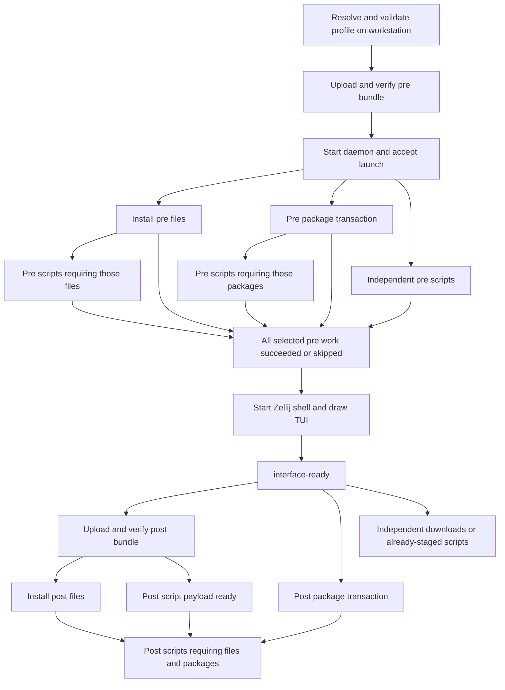

# Developing configurable launches

Status: offline compiler and verified archive tooling implemented, 2026-11-06. `beams config validate`
and `beams config explain` resolve and validate profiles without contacting
Teleport, reading client state, installing packages, or invoking hooks.
`beams ssh` still uses the existing startup path. Execution, archive
upload, readiness signals, and profile selection during SSH are
the next milestones. The full
[launch design](../designs/LAUNCH_CONFIGURATION_DESIGN.md) records the
proposal and migration.

## Inspect a profile today

From the checkout root, after building the client:

```sh
cargo build --manifest-path client/Cargo.toml
client/target/debug/beams config validate
client/target/debug/beams config explain --profile builtin:core
client/target/debug/beams config explain \
  --profile environments/examples/team/environment.toml
client/target/debug/beams config explain \
  --profile environments/examples/team/environment.toml --json
```

The default for these commands is `builtin:development`. Both bundled
profiles and their small assets are embedded in the client; inspection
works from an installed binary outside this checkout. `--profile` also
accepts a local TOML file. An invalid explicit profile fails; it never
falls back to the default.

For a private starting point, copy `environments/examples/team/` to
`environments/local/` (gitignored), then edit its profile and helpers.
`config init`, workstation-wide `[launch].profile`, and `ssh --profile`
are not implemented yet.

The development starter selects fish and its configuration before the
interface, with micro/less and Go/Rust afterward. It contains no SSH keys,
cluster bot, Kubernetes settings, or maintainer project checkouts. The
old startup's remaining optional installers will move into this profile
as their generic execution primitives become available.

## Profile schema v1

Every file needs `schema_version = 1`. Unknown fields are errors at every
level. `extends = ["builtin:development", "./team.toml"]` applies bases in
listed order, recursively, then the child. Inheritance only reads local
files and bundled names; cycles fail with the path chain.

| Section | Fields |
|---|---|
| `[shell]` | `program` (absolute remote executable), `path` (remote directories), `change_login_shell` (default false) |
| `[env]` | String values keyed by environment variable name |
| `[packages.pre]`, `[packages.post]` | `add`, `remove` arrays of Debian `name[:arch][=version]` strings |
| `[files.ID]` | `source`, `target`, `phase`, `mode`, `overwrite`, `exclude`, `after`, `enabled` |
| `[tasks.ID]` | `label`, `phase`, `script` or `template`, `script_root`, `exclude`, `interpreter`, `args`, `working_dir`, `env`, `check`, `after`, `resources`, `packages`, `params`, `rerun`, `enabled` |
| `[templates.ID]` | Script execution fields, `label`, `packages`, `resources`, `params`, `enabled` |

IDs use letters, numbers, `_`, or `-`. Named files, tasks and templates
replace the entire inherited entry; `enabled = false` removes it. Shell
fields merge individually, environment values merge by key, and all
explicit arrays other than package edits replace their previous value.
Defaults are `phase = "post"`, `mode = "copy"`, `overwrite = "deny"`,
`interpreter = ["bash"]`, and `rerun = "manual"`. Disabled entries need
no other fields. A task must select exactly one of `script` or `template`.

Package edits apply as a stable union followed by removal by package name
within that phase. Pinned and unpinned requirements agree on the pin;
different pins fail. A package selected in both phases is installed in
pre only. A task requiring it waits on `packages:pre`, even if the task
is post. Removing a required package fails unless an earlier pre batch
supplies it; disable or change its consumer instead. Selecting
`/usr/bin/fish` automatically requires fish in pre. Other shell executables
must be supplied by configured packages/files/hooks.

`source`, `script`, and `script_root` are local, relative to the declaring
file (including inherited definitions). Existing files/directories are
checked with metadata only by validate/explain. Recursive enumeration,
hashing, symlink-tree validation and source snapshots occur during phase
packing. `exclude` currently accepts root-relative path prefixes, without
globs or `..`. A script's entrypoint cannot be excluded. Without a
`script_root`, only that file is selected, not its sibling helpers.

File targets and shell PATH entries use absolute Beam paths, `~/...` or
`${beam.home}/...`. The compiler normalizes these without using the
workstation's HOME. Interpreter/check argv and environment values remain
remote inputs. A script `working_dir` may also be relative to its
extracted entrypoint directory. The future runner resolves Beam variables
and supplies `BEAMS_SCRIPT_DIR` / `BEAMS_SCRIPT_ROOT`; inspection does
not perform remote expansion.

Built-in parameter schemas live in `protocol/src/task_catalog.rs`, shared
with bootstrap's CLI/TUI metadata and checked against its instantiator by
bootstrap tests. The compiler supports all current templates. Code-server
gets automatic Go/Rust prerequisite tasks when absent; an SSH clone gets
`wait-ssh-agent`. A PR checkout requires a configured clone at its base
destination. SSH key authorization remains independent of profiles.

Custom templates use `template = "user:NAME"`:

```toml
[templates.fetch]
script = "./hooks/fetch.sh"
args = ["--name", "${param.name}"]
packages = ["curl"]

[templates.fetch.params.name]
kind = "string"
default = "example"

[tasks.fetch-data]
template = "user:fetch"
params = { name = "team-data" }
```

Parameter kinds are `string`, `path` (remote), `number` (integer), and
`boolean`; absence of a default makes a parameter required. Substitution
is limited to interpreter/argument/check argv, environment values, and
remote working directories. It does not rewrite script source or change
local upload roots. Values remain individual argv entries; shell quoting
is not performed. Task instances supply phase, dependencies, label,
package/resource additions, and rerun policy; script execution fields
belong to the template definition.

`explain --json` contains a `plan` plus workstation-only `profiles`,
`origins`, `sources`, and explanatory `notes`. The plan has no authoritative
local source paths. Its node/artifact IDs and schema describe compiler
output, not an accepted daemon request. Packing wraps that plan in a
declaration with a launch UUID and plan digest, and freezes each phase's
payload separately. Negotiated runtime versions and daemon acceptance are
pending. Human output shows values/origins, package selections, artifact
roots, pre promotion, graph dependencies and resource declarations.

## Snapshot, pack and verify

These commands work today without contacting Teleport:

```sh
client/target/debug/beams config pack \
  --profile environments/examples/team/environment.toml --output /tmp/team-launch
bootstrap/target/debug/beam-bootstrap launch unpack \
  --archive /tmp/team-launch/pre/bundle.tar.gz \
  --descriptor /tmp/team-launch/pre/descriptor.json --output /tmp/team-stage/pre

# Deferred operation: run only once the interface is ready in the future launcher.
client/target/debug/beams config pack-post --launch-dir /tmp/team-launch
bootstrap/target/debug/beam-bootstrap launch unpack \
  --archive /tmp/team-launch/post/bundle.tar.gz \
  --descriptor /tmp/team-launch/post/descriptor.json --output /tmp/team-stage/post
```

Pack publishes a new private directory containing the frozen declaration,
workstation-only `local-inputs.json`, and the pre archive/descriptor. It
does not enumerate post roots. Pack-post snapshots those sources at the
later call; retries reuse its completed spool instead of rereading sources.
Select `--compression none` for plain tar; gzip defaults to level 1.
Bundle bytes are deterministic for a fixed declaration/content/mode set.

Only declaration and phase archive/descriptor are remote inputs. Source
paths in `local-inputs.json` stay local. The profile payload bundle does
not yet include the bootstrap runtime or Zellij; the unpack binary must
already be installed. The future SSH transport will transfer one bundle
per phase, rather than invoking scp for each file.

`bundle.json` binds the archive to a launch ID, plan digest and phase.
Every artifact has a staging-relative root and a hashed list of entry paths,
types, sizes, modes and content hashes. Ownership, timestamps, ACLs, xattrs
and host metadata are not copied. Ordinary mode bits and empty directories
are preserved in the manifest. Internal symlinks must resolve to selected
entries within their own artifact; dangling, excluded or external targets
and special files fail. Directory symlink targets are preserved without
recursively traversing them during snapshotting.

The receiver hashes a private copy of the entire stream before decoding,
checks every payload against the manifest, creates links after regular
entries, seals staged payloads read-only and atomically publishes the
generation. Receipt checks include the launch/plan/phase binding. Repeat
receives verify existing contents; different bundles cannot replace them.
Interrupted/invalid extraction leaves no published generation. Whole
archive retries are supported; byte-offset resume is not.

Packing/receiving alone never installs files or executes hooks. Only
successful receive can release `artifact-ready:<phase>`; a subsequent
file-install task will release `files:<ID>`. Installation and automated
readiness signaling remain the next runtime milestone.

## Ownership and execution

The planned runtime follows this ownership: the workstation resolves
profiles, snapshots selected local sources, and
owns archive uploads and SSH grants. The Beam daemon runs package, file,
and script tasks through the existing executor. Zellij and the TUI are
clients of that daemon; neither owns task scheduling.

There is a pre phase that blocks session creation and a post phase that
waits for the initial shell and TUI to become ready. Within each phase,
dependencies and exclusive resources determine execution, not declaration
order or a global "packages, then scripts" sequence.



This is an example graph, not fixed waves. A task starts as soon as its
own prerequisites and resources allow it. An upload is a workstation job;
the Beam waits on its verified artifact readiness.

## Ordering contract

| Work | Required before it starts |
|---|---|
| File installation | Its archive's `artifact-ready:<bundle>` condition |
| Package batch | Its declared source/keyring preparation and package prerequisites |
| Any script | Its uploaded entrypoint/helper artifact and declared dependencies |
| Any post task | `interface-ready`, plus its own prerequisites |
| Session creation | Every selected pre task succeeded or skipped |
| Hook needing copied files | Successful installation of those named file entries |
| Hook needing installed packages | The package capabilities/batch that supplies them |

`phase = "pre"` means before the interface; it does not mean after the pre
package batch. A script without package dependencies may run concurrently
with apt. Package requirements declared by a task/template contribute to
the compiler's appropriate batch and create dependency edges. An explicit
`after = ["packages:post"]` waits for the entire post batch, including when
it skips because the packages already exist.

`after = ["files:data"]` waits for the data to be installed at its target,
not merely uploaded into staging. The `artifact-ready` condition certifies
complete receipt, digest verification, validated extraction, and publication
of staging; file installation is a separate graph node.

A resource such as `apt` or a toolchain destination enforces mutual
exclusion; it does not establish which task goes first or provide a
capability. Two independent downloads can overlap apt. Two apt mutations
serialize, and the cross-process package helper protects against other
bootstrap invocations. A script mutating apt must use that helper rather
than relying solely on a scheduler resource tag.

No pre task may depend on a configured post task. Automatically inserted
prerequisite chains and shared script roots can be promoted into pre;
`config explain` shows why they block the interface. A configured provider
keeps its phase; change that declaration to pre if a pre consumer needs it.

## Example: configure files after packages

This syntax is accepted by the offline compiler:

```toml
[tasks.configure]
phase = "post"
script = "./hooks/configure.sh"
script_root = "./hooks"
interpreter = ["bash"]
after = ["files:data", "packages:post"]
```

The compiler includes the local helper directory in the post archive and
adds artifact, file-installation, package-batch, and interface readiness
requirements. The hook runs when all four are satisfied. An unrelated
download starts after interface readiness without waiting for that hook.

Local source paths, including script roots, resolve against their declaring
profile even through inheritance. Execution, interpreter commands, checks,
and working directories are on the Beam. The default working directory is
the extracted entrypoint directory; use `BEAMS_SCRIPT_DIR` /
`BEAMS_SCRIPT_ROOT` to address helpers independently of a changed cwd.

Helper invocations belong to their caller's task and share its logs and
resource ownership. Use separate named tasks for independently scheduled
work or separate TUI status.

## Adding or changing a task

1. Define its parameters, desired-state probe or explicit retry policy,
   capabilities, package needs, and exclusive resources. Keep package
   preparation separate from long user-space downloads so apt is released.
2. Register it through the shared template catalog, expose it through task
   CLIs and TUI metadata, and preserve existing schema/coverage checks.
   Add its package/capability/resource rules to the profile compiler
   (`client/src/config/plan.rs`) and matching ordering fixtures. Custom
   script templates use the same planned graph and progress contracts.
3. Declare file/script artifacts and dependency edges. Check inherited
   source origins and phase promotion in the compiled plan; do not depend
   on TOML entry order, an installer subprocess changing a pane's
   environment, or unrecorded state from another submission.
4. Emit progress and terminal state through the existing event path.
   Capture subprocess logs, propagate task/client identity and relay
   environment, and record completion only after success.
5. Verify the new behavior with compiler/executor fixtures or a disposable
   Beam where system state is involved. Cover failure blocking, resource
   conflicts, retry, and reconnect when relevant.
6. Update this guide, the relevant binary README, and the task's entry in
   `TODO.md` in the same change.

## Failures and recovery

The following is the runtime contract to implement, not current compiler
functionality:

A failed task blocks its dependents; unrelated tasks continue. A pre
failure prevents session creation. A post failure remains visible without
closing the shell. `check` runs again on retry; successful `on-change`
records include the script/helper content identity. Interrupted unchecked
scripts require explicit retry.

The launch ID makes acceptance retries refer to the same launch. A task
snapshot restores progress on UI reconnect. Upload retries restart the
archive in the first implementation, and only verified staging releases
artifact readiness. Inspecting a plan or explaining ordering runs offline
and never installs packages or invokes hooks.

## Documentation required during implementation

Deliver profile/schema and `config explain` examples with the compiler;
package/file/script extension guidance with execution primitives; readiness
and reconnect walkthroughs with the new launcher; and a complete annotated
development profile before switching defaults. Add actual command examples
as they land, including diagnosis of package waits, missing artifacts,
phase errors, and failed hooks.

Document a supported end-to-end example whose expected graph is also
checked by fixtures. Execution-order examples are part of acceptance,
so changes to implicit prerequisites must update both the guide and those
fixtures.

## Checked execution-order example

`environments/examples/team/environment.toml` extends development, disables
its Go task, adds `jq`/`curl`, and selects a post data directory. Both hooks
use one helper root. The prepare hook is pre and waits for fish's config;
the configure hook is post and declares `jq` plus `files:data`.

Selected lines from `config explain` are:

```text
tasks:prepare [pre] Prepare shell files (script: artifact-4/prepare.sh)
packages:pre [pre] pre packages (packages: fish)
packages:post [post] post packages (packages: micro, less, jq, curl, gcc)
tasks:configure [post] Configure project data (script: artifact-4/configure.sh)
```

The artifact root for the hooks is promoted into pre, while the data root
stays post. Packing now produces those phase archives. The key dependencies
are:

| Node | Dependencies relevant to this example |
|---|---|
| `files:fish` | `runtime-ready`, `artifact-ready:pre` |
| `tasks:prepare` | `runtime-ready`, `artifact-ready:pre`, `files:fish` |
| `interface-ready` | Every pre node, including `tasks:prepare` and `packages:pre` |
| `packages:post` | `runtime-ready`, `interface-ready` |
| `files:data` | `runtime-ready`, `interface-ready`, `artifact-ready:post` |
| `tasks:configure` | `runtime-ready`, `interface-ready`, `artifact-ready:pre`, `files:data`, `packages:post` |
| `tasks:rust` | `runtime-ready`, `interface-ready`, `packages:post` |

Prepare can overlap apt once fish's **config file** is installed: it does
not execute fish or require the fish package. Session creation waits for
both. Post apt can overlap the post upload. Configure waits for data and
apt, but its helpers are already staged. Rust waits for the post batch
because its gcc prerequisite is included there; Go has no apt dependency.
The old Rust task still performs its own apt work today; splitting that
task is required before wiring this compiled graph into launches.

`client/src/config/tests.rs` checks this profile's batches, artifact
assignment, named-entry removal, and dependencies, along with invalid
graphs and inherited sources. `client/tests/config.rs` runs the real CLI
outside a checkout with a trap `tsh`, checking offline behavior and no
fallback on invalid configuration.
