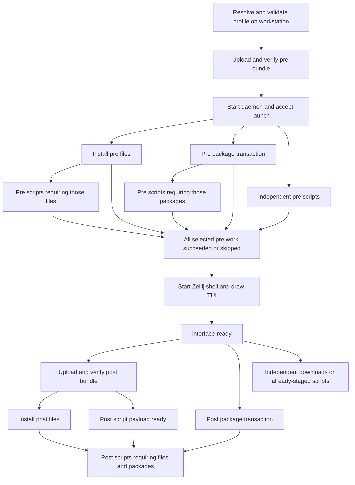

# Developing configurable launches

Status: offline compiler, verified archive tooling and foreground execution
foundation implemented, 2026-11-06. `beams config validate`
and `beams config explain` resolve and validate profiles without contacting
Teleport, reading client state, installing packages, or invoking hooks.
`beams ssh` still uses the existing startup path. The opt-in headless runner
executes package/file/script graphs, and the daemon accepts launches, waits
for their conditions and releases the interface from shell/TUI readiness.
`beams config launch` drives a profile onto an existing Beam over its
bridge (upload, submission, post after the interface), and
`beams ssh --profile` creates a Beam for one (runtime delivery without a
checkout, pre before the shell, a per-launch Zellij session). The full
[launch design](../designs/LAUNCH_CONFIGURATION_DESIGN.md) records the
proposal and migration.

## Inspect a profile today

From the checkout root, after building the client:

```sh
cargo build --manifest-path client/Cargo.toml
client/target/debug/beams config validate
client/target/debug/beams config explain --profile builtin:core
client/target/debug/beams config explain \
  --profile environments/examples/team/environment.toml
client/target/debug/beams config explain \
  --profile environments/examples/team/environment.toml --json
```

The default for these commands is `builtin:development`. Both bundled
profiles and their small assets are embedded in the client; inspection
works from an installed binary outside this checkout. `--profile` also
accepts a local TOML file. An invalid explicit profile fails; it never
falls back to the default.

For a private starting point, copy `environments/examples/team/` to
`environments/local/` (gitignored), then edit its profile and helpers.
`beams ssh --profile` and workstation-wide `[launch] profile` launch a new
Beam with a profile (see
[below](#launch-a-new-beam-beams-ssh---profile)); `config init` is not
implemented yet.

The development starter selects fish, its configuration and starship (the
`install-starship` template, downloaded while pre's apt batch runs) before
the interface, so the first prompt is complete, with micro/less and
Go/Rust afterward. It contains no SSH keys,
cluster bot, Kubernetes settings, or maintainer project checkouts. The
old startup's remaining optional installers will move into this profile
as their generic execution primitives become available.

## Profile schema v1

Every file needs `schema_version = 1`. Unknown fields are errors at every
level. `extends = ["builtin:development", "./team.toml"]` applies bases in
listed order, recursively, then the child. Inheritance only reads local
files and bundled names; cycles fail with the path chain.

| Section | Fields |
|---|---|
| `[shell]` | `program` (absolute remote executable), `path` (remote directories), `change_login_shell` (default false) |
| `[env]` | String values keyed by environment variable name |
| `[packages.pre]`, `[packages.post]` | `add`, `remove` arrays of Debian `name[:arch][=version]` strings |
| `[files.ID]` | `source`, `target`, `phase`, `mode`, `overwrite`, `exclude`, `after`, `enabled` |
| `[tasks.ID]` | `label`, `phase`, `script` or `template`, `script_root`, `exclude`, `interpreter`, `args`, `working_dir`, `env`, `check`, `after`, `resources`, `packages`, `params`, `rerun`, `enabled` |
| `[templates.ID]` | Script execution fields, `label`, `packages`, `resources`, `params`, `enabled` |
| `[ssh_grant]` | `hosts`, `user` (default `git`), `window_secs` (default 600, max 3600), `max_uses` (default: covered tasks + 2), `tasks` (default: `clone-git-repo` tasks with an SSH `repo`) |

IDs use letters, numbers, `_`, or `-`. Named files, tasks and templates
replace the entire inherited entry; `enabled = false` removes it. Shell
fields merge individually, environment values merge by key, and all
explicit arrays other than package edits replace their previous value.
Defaults are `phase = "post"`, `mode = "copy"`, `overwrite = "deny"`,
`interpreter = ["bash"]`, and `rerun = "manual"`. Disabled entries need
no other fields. A task must select exactly one of `script` or `template`.

Package edits apply as a stable union followed by removal by package name
within that phase. Pinned and unpinned requirements agree on the pin;
different pins fail. A package selected in both phases is installed in
pre only. A task requiring it waits on `packages:pre`, even if the task
is post. Removing a required package fails unless an earlier pre batch
supplies it; disable or change its consumer instead. Selecting
`/usr/bin/fish` automatically requires fish in pre. Other shell executables
must be supplied by configured packages/files/hooks.

`source`, `script`, and `script_root` are local, relative to the declaring
file (including inherited definitions). Existing files/directories are
checked with metadata only by validate/explain. Recursive enumeration,
hashing, symlink-tree validation and source snapshots occur during phase
packing. `exclude` currently accepts root-relative path prefixes, without
globs or `..`. A script's entrypoint cannot be excluded. Without a
`script_root`, only that file is selected, not its sibling helpers.

File targets and shell PATH entries use absolute Beam paths, `~/...` or
`${beam.home}/...`. The compiler normalizes these without using the
workstation's HOME. Interpreter/check argv and environment values remain
remote inputs. A script `working_dir` may also be relative to its
extracted entrypoint directory. The runner resolves Beam variables
and supplies `BEAMS_SCRIPT_DIR` / `BEAMS_SCRIPT_ROOT`; inspection does
not perform remote expansion.

Built-in parameter schemas live in `protocol/src/task_catalog.rs`, shared
with bootstrap's CLI/TUI metadata and checked against its instantiator by
bootstrap tests. The compiler supports all current templates. Code-server
gets automatic Go/Rust prerequisite tasks when absent; an SSH clone gets
`wait-ssh-agent`. A PR checkout requires a configured clone at its base
destination. SSH key authorization remains independent of profiles.

Custom templates use `template = "user:NAME"`:

```toml
[templates.fetch]
script = "./hooks/fetch.sh"
args = ["--name", "${param.name}"]
packages = ["curl"]

[templates.fetch.params.name]
kind = "string"
default = "example"

[tasks.fetch-data]
template = "user:fetch"
params = { name = "team-data" }
```

Parameter kinds are `string`, `path` (remote), `number` (integer), and
`boolean`; absence of a default makes a parameter required. Substitution
is limited to interpreter/argument/check argv, environment values, and
remote working directories. It does not rewrite script source or change
local upload roots. Values remain individual argv entries; shell quoting
is not performed. Task instances supply phase, dependencies, label,
package/resource additions, and rerun policy; script execution fields
belong to the template definition.

`explain --json` contains a `plan` plus workstation-only `profiles`,
`origins`, `sources`, and explanatory `notes`. The plan has no authoritative
local source paths. Its node/artifact IDs and schema describe compiler
output, not an accepted daemon request. Packing wraps that plan in a
declaration with a launch UUID and plan digest, and freezes each phase's
payload separately. Negotiated runtime versions and daemon acceptance are
pending. Human output shows values/origins, package selections, artifact
roots, pre promotion, graph dependencies and resource declarations.

## Snapshot, pack and verify

These commands work today without contacting Teleport:

```sh
client/target/debug/beams config pack \
  --profile environments/examples/team/environment.toml --output /tmp/team-launch
bootstrap/target/debug/beam-bootstrap launch unpack \
  --archive /tmp/team-launch/pre/bundle.tar.gz \
  --descriptor /tmp/team-launch/pre/descriptor.json --output /tmp/team-stage/pre

# Deferred operation: run only once the interface is ready in the future launcher.
client/target/debug/beams config pack-post --launch-dir /tmp/team-launch
bootstrap/target/debug/beam-bootstrap launch unpack \
  --archive /tmp/team-launch/post/bundle.tar.gz \
  --descriptor /tmp/team-launch/post/descriptor.json --output /tmp/team-stage/post
```

Pack publishes a new private directory containing the frozen declaration,
workstation-only `local-inputs.json`, and the pre archive/descriptor. It
does not enumerate post roots. Pack-post snapshots those sources at the
later call; retries reuse its completed spool instead of rereading sources.
Select `--compression none` for plain tar; gzip defaults to level 1.
Bundle bytes are deterministic for a fixed declaration/content/mode set.

Only declaration and phase archive/descriptor are remote inputs. Source
paths in `local-inputs.json` stay local. The profile payload bundle does
not yet include the bootstrap runtime or Zellij; the unpack binary must
already be installed. The future SSH transport will transfer one bundle
per phase, rather than invoking scp for each file.

`bundle.json` binds the archive to a launch ID, plan digest and phase.
Every artifact has a staging-relative root and a hashed list of entry paths,
types, sizes, modes and content hashes. Ownership, timestamps, ACLs, xattrs
and host metadata are not copied. Ordinary mode bits and empty directories
are preserved in the manifest. Internal symlinks must resolve to selected
entries within their own artifact; dangling, excluded or external targets
and special files fail. Directory symlink targets are preserved without
recursively traversing them during snapshotting.

The receiver hashes a private copy of the entire stream before decoding,
checks every payload against the manifest, creates links after regular
entries, seals staged payloads read-only and atomically publishes the
generation. Receipt checks include the launch/plan/phase binding. Repeat
receives verify existing contents; different bundles cannot replace them.
Interrupted/invalid extraction leaves no published generation. Whole
archive retries are supported; byte-offset resume is not.

Packing/receiving alone never installs files or executes hooks. Only
successful receive can release `artifact-ready:<phase>`; a subsequent
file-install task releases `files:<ID>`. Foreground installation is now
implemented, and the daemon path releases `interface-ready` from shell/TUI
readiness reports (below).

## Execute a verified graph today

`beam-bootstrap launch run-phase` is an opt-in foreground adapter to the
existing executor. It mutates the Beam's targets, runs selected hooks and
installs selected packages. It does not start/restart the daemon or spawn
Zellij. With the team bundles from the preceding example:

```sh
# On the target Beam, after pre has been unpacked:
beam-bootstrap launch run-phase \
  --launch /tmp/team-launch/launch.json --staging /tmp/team-stage --phase pre

# After the workstation packs post and the Beam unpacks it:
beam-bootstrap launch run-phase \
  --launch /tmp/team-launch/launch.json --staging /tmp/team-stage \
  --phase post --headless
```

Post requires an explicit headless policy and a matching successful pre
receipt. It never silently substitutes a timeout for shell/TUI readiness.
Each invocation verifies staged contents and launch/plan/phase identity.
Whole-graph dependency, phase and native-template validation precedes task
effects. The foreground `runtime-ready` adapter prepares configured PATH
directories; it assumes this bootstrap runtime is already delivered.
Session spawning, shell selection/export and login-shell changes belong
to the upcoming launcher.

Nodes provide launch-scoped capabilities. Post may omit a pre dependency
only after that launch's successful pre receipt; a different launch's
capabilities cannot satisfy it. Within the selected phase the existing
dependency-driven executor schedules ready tasks immediately. It does not
wait for unrelated tasks to finish a wave. Missing post staging fails its
condition and blocks its consumers while post tasks using a promoted pre
helper root can still run. Unpack the missing bundle and retry, or submit
the launch to the daemon, which waits for it (next section).

JSON-lines `task_status` events go to stdout with the launch UUID as
`manifest_id`, namespaced task IDs and `start`/`progress`/`ok`/`skip`/
`error`/`blocked` states. The process exits 0/1 for the phase result.
Both stdout and stderr from hooks/apt are drained with bounded chunks
and queues. These foreground events are not daemon broadcasts or retained
snapshots; the daemon path below provides both.

## Run a launch through the daemon

`beam-bootstrap launch submit` hands a verified declaration to the running
`beam-bootstrapd`. It accepts the launch durably, then runs pre and post on
one worker with the daemon's shared executor resources, so concurrent
launches and manifests serialize on the same `exclusive_resources` (apt,
destination paths, a hook's declared `resources`). External conditions wait
instead of failing:

```sh
beam-bootstrap launch submit --launch /tmp/team-launch/launch.json --staging /tmp/team-stage
# elsewhere, as inputs arrive:
beam-bootstrap launch unpack ... --output /tmp/team-stage/pre
beam-bootstrap launch signal --launch-id ID --condition artifact-ready:pre
beam-bootstrap launch ready --launch-id ID --component shell   # the initial shell does this
beam-bootstrap launch ready --launch-id ID --component tui     # the TUI does this
beam-bootstrap launch receive --launch-id ID --phase post \
  --archive /tmp/team-launch/post/bundle.tar.gz --descriptor /tmp/team-launch/post/descriptor.json
beam-bootstrap launch status [--launch-id ID] [--json]
beam-bootstrap launch retry --launch-id ID [--retry-interrupted]
```

`submit` follows the launch until it finishes and exits 0/1 (`--no-follow`
returns once accepted). Staging may be unpacked before submission: the
worker probes both phases when it starts.

- **Acceptance.** Keyed by launch UUID and plan digest, written to
  `<state>/<launch ID>/accepted.json` before any effect. Resubmitting the
  same declaration returns the existing launch (`existing: true`) and
  starts nothing; the same UUID with a different digest is refused.
  `<state>` is `launch-state/` next to the daemon socket
  (`~/.beam-bootstrap/launch-state/` by default, the same root `run-phase`
  uses, so receipts, locks and hook history agree).
- **`artifact-ready:<phase>`** waits until the daemon verifies that phase's
  staging itself. `launch receive` (op `launch_receive`) hands it an
  archive and descriptor: the daemon checks they belong to this launch,
  plan and phase, verifies and publishes `<staging>/<phase>` (the same
  `receive` as `unpack`), and releases the condition, exiting 0 once it is
  released (also for an archive already staged) or 1 if staging fails.
  Staging unpacked some other way is probed when the worker starts or on
  `launch signal`; signalling with nothing staged leaves it waiting (the
  CLI exits 1). Staging that fails verification fails the condition and
  blocks its consumers.
- **`interface-ready`**, with the default interactive gate, waits until
  both the initial shell and the TUI report `launch ready` (its waiting
  message names whichever is missing). `launch signal --condition
  interface-ready` is the manual override; `--headless` releases it as soon
  as pre succeeds. There is no timer: a missing report is a visible wait.
  Reports are recorded once (other panes repeating them change nothing),
  may arrive before the launch is accepted, are kept in the snapshot's
  `ready`, and survive a retry, since the interface is still up. Post nodes
  that need only pre artifacts proceed once the interface is ready, while
  post-bundle consumers still wait for their bundle.
- **Who reports.** Both read `BEAMS_LAUNCH_ID`; without it neither does
  anything, so the fixed startup is unaffected. The shell's report comes
  from `shell/fish/conf.d/beams-launch.fish` at the first interactive
  prompt (in the background, via `$BEAM_BOOTSTRAP_BIN` or `beam-bootstrap`
  on `PATH`). The TUI reports after the first frame drawn with its launch's
  snapshot applied, unless that snapshot already has `tui` or a released
  interface. Getting `BEAMS_LAUNCH_ID` into the Zellij session is the
  launcher's job (the next slice); until then, export it yourself.
- **Failure and retry.** A failed pre blocks every post node and fails the
  launch. `launch retry` reruns a failed or interrupted launch with its
  accepted plan (completed hooks skip as usual; `--retry-interrupted` as for
  `run-phase`). Running or successful launches refuse retry.
- **Restart.** A restarted daemon reloads accepted launches. One that
  hadn't finished becomes `interrupted` with its unfinished nodes; it is not
  resumed automatically (an old installer may still be running), only by
  `launch retry`.
- **Environment.** Hooks get the agent relay as `SSH_AUTH_SOCK` (unless the
  profile or task sets one) and `BEAMS_TASK_RUN`, like native tasks, since
  the daemon's own environment predates the relay.

### Daemon ops, events and snapshots

The CLI is a thin client of six ops on the daemon socket:

```json
{"request_id": "1", "op": "launch_submit", "launch": "/abs/launch.json", "staging": "/abs/stage", "gate": "interactive"}
{"request_id": "2", "op": "launch_signal", "launch_id": "...", "condition": "artifact-ready:post"}
{"request_id": "3", "op": "launch_snapshot", "launch_id": "..."}
{"request_id": "4", "op": "launch_retry", "launch_id": "...", "retry_interrupted": false}
{"request_id": "5", "op": "launch_ready", "launch_id": "...", "component": "shell"}
{"request_id": "6", "op": "launch_receive", "launch_id": "...", "phase": "post", "archive": "/abs/bundle.tar.gz", "descriptor": "/abs/descriptor.json"}
```

Replies are `launch_accepted` (`existing`, `seq`, `launch`),
`launch_signaled` (`released`, `message`), `launch_snapshot` (`seq`,
`launches`), `launch_retrying` (`seq`, `launch`), `launch_ready`
(`accepted`: false when recorded ahead of acceptance), `launch_receiving`
(staging continues in the background; its outcome is a `launch_condition`)
or `error`. A launch
snapshot has the launch's `status` (`accepted`, `running`, `ok`, `failed`,
`interrupted`), its gate, `ready` (interface components that reported),
`released` (conditions released, in order), and every node with `status` (`pending`,
`waiting`, `running`, `ok`, `skip`, `error`, `blocked`, `interrupted`),
its last message and its last 10 progress lines. Snapshots are persisted
on lifecycle transitions as `snapshot.json`.

Broadcasts are `launch_status`, `task_status`, `launch_condition`
(`condition`, `released`, `message`: each release once, each verification
failure as it happens), `launch_ready` (`component`, `ready`) and
`launch_nodes_blocked` (`phase`, `nodes`, `message`, when a failed pre
blocks post). `task_status` has the shape the Beam TUI already renders,
with `manifest_id` set to the launch ID, plus `launch_id`, `node`, and
`waiting: true` while a condition waits. Every launch event carries a daemon-wide `seq`. Replies that carry
launch state are queued while holding the lock under which events are
numbered, so they are exact boundaries: a client that connects (every
connection receives broadcasts), requests a snapshot, applies it, and
ignores events with `seq` at or below the snapshot's neither misses nor
duplicates a transition. The Beam TUI does exactly that: it requests
`launch_snapshot` when it connects, after reconnecting, and whenever a
launch is (re)accepted, replaces that launch's rows with the snapshot's
nodes (so pending post work is listed before it runs, labelled
`phase · label`), and drops launch events at or below the snapshot's `seq`.
`bootstrap/tests/launch-daemon-smoke.sh` drives all of this with the real
binaries in a scratch directory, including the real TUI on a pseudo-terminal
reporting its readiness.

### Launches over the workstation bridge

A workstation drives the same daemon path over its bridge, with the
`launch` capability (`CAPABILITY_LAUNCH`) advertised by both sides. It
never sends a path: it uploads the declaration and each phase's bundle,
and the Beam decides where they go.

```text
workstation                                  Beam
LaunchUploadBegin{declaration, bytes, sha256} → LaunchUploadOffset{offset}
LaunchUploadChunk{offset, data} ...           → LaunchUploadOffset{offset} ... LaunchUploaded
LaunchSubmit{launch_id, plan_digest, gate}    → LaunchAccepted{existing, status, released}
LaunchUploadBegin{pre, ..., descriptor} ...   → ... LaunchUploaded
                                              ← LaunchCondition{artifact-ready:pre, released}
                                              ← LaunchStatus{running} ...
                                              ← LaunchCondition{interface-ready, released}
LaunchUploadBegin{post, ...} ...              → ... LaunchUploaded
                                              ← LaunchCondition{artifact-ready:post} ... LaunchStatus{ok}
```

- **Chunks.** At most `UPLOAD_CHUNK_BYTES` (32 KiB) of base64 data each,
  so a frame stays well under the bridge's 64 KiB limit. The workstation
  keeps at most `UPLOAD_WINDOW` (8) chunks unacknowledged, so an SSH agent
  request queued behind a large post bundle waits for a few frames, not
  the whole bundle. Each chunk is acknowledged with the bytes now held; a
  duplicate or out-of-order chunk isn't written, and the reply says where
  to continue. `LaunchUploadBegin` answers with the bytes already held, so
  after a dropped bridge an upload resumes rather than restarting.
- **Verification.** A blob is published only when its size and SHA-256
  match what its upload began with (`LaunchUploadFailed` otherwise: begin
  again). A bundle must name its descriptor, which must agree with the
  upload, the launch and (once accepted) its plan digest. Declarations are
  bounded at 4 MiB. Post can't be uploaded before the launch is accepted;
  pre may arrive first and is staged at acceptance.
- **Staging.** A complete bundle is received exactly as by `launch
  receive`, into `launch-state/<launch ID>/staging/<phase>`, releasing
  `artifact-ready:<phase>`; no signal is involved. Consumed uploads are
  deleted. Spools live in `launch-uploads/<launch ID>/` next to the
  daemon socket (0700, files 0600): `<blob>.json` (what the upload began
  with), `<blob>.part`, then `<blob>`.
- **Ownership.** The submitting workstation (its `client_id`) is recorded
  in `accepted.json`; `LaunchStatus` and `LaunchCondition` go only to its
  ready, launch-capable bridges, and node-level progress stays on the
  Beam. A resubmission (same ID and digest) answers `existing: true` with
  the current status and released conditions, even after the declaration
  upload was consumed; that, and re-beginning uploads, is how a
  reconnecting workstation recovers. A different digest is rejected. A
  launch submitted on the Beam itself (no owner, as `launch start` does)
  is adopted by the first bridge client that submits it, and that is
  persisted.

- **Throughput.** Uploads are bounded by the window: about
  256 KiB per bridge round trip (≈2.5 MiB/s at 100 ms), plus a third for
  base64. That is ample for pre bundles and off the interface's critical
  path for post, but unmeasured against real workstations; a large post
  tree may want a larger window or a separate transport later
  (`docs/designs/LAUNCH_CONFIGURATION_DESIGN.md`). The workstation bridge
  writes each queued message immediately (it used to poll every 50 ms,
  capping every bridge message, sign responses included, at 20/s).

The workstation side is `beams config launch` (see
[the client README](../../client/README.md#beams-config-launch)): the
daemon records the launch before uploading, and each time the Beam's
bridge connects it re-drives unfinished launches from the top (begin the
declaration upload, which the Beam answers at once if it has it; submit;
upload pre unless released; pack and upload post once `interface-ready`
is). `client/tests/launch-bridge-smoke.sh` runs a headless and an
interactive launch through the real workstation daemon, bridge adapter and
Beam daemon with a fake `tsh`, including a multi-MiB post bundle.

### Launch a new Beam: `beams ssh --profile`

`beams ssh --profile PROFILE` (or `[launch] profile` in the workstation's
`config.toml`) creates a Beam for a launch instead of the legacy
repo-checkout startup. It's opt-in; without a profile, `beams ssh` is
unchanged.

```text
workstation                                   Beam
pack profile (fails before any Beam exists)
tsh beams add, wait for SSH
scp ~/.beams/ (runtime + launch.json + pre)   →
StartLaunch to the local daemon, then bridge
tsh ssh -- …/beam-bootstrap launch start      → beamctl start beam-bootstrapd (runtime binary)
                                                launch_submit (local, no owner)
                                                launch receive pre   ‖ install Zellij
                                                pre progress printed in the terminal
                                                exec zellij attach beams-<id> --create
bridge: LaunchSubmit                          → existing: adopts the bridge client as owner
                                              ← LaunchCondition{interface-ready} (shell + tui)
post packed and uploaded                      → … LaunchStatus{ok}
```

- **Runtime.** `~/.beams/runtime/` holds `bin/beam-bootstrap`,
  `bin/beams-shell` and `zellij/beams-launch.kdl` (sources in
  `shell/runtime/`, embedded in the client). The launch itself is under
  `~/.beams/launches/<ID>/`. No `~/beams` checkout unless `--push-repo`.
  The bridge runs the runtime's `client-bridge` when present, else the
  legacy `~/beams/bin/beam-client-bridge`.
- **Session.** One Zellij session per launch (`beams-` plus the first
  group of the launch ID), so an attach never reuses another launch's
  environment. Its environment is the plan's (`[env]`, `[shell] path`
  ahead of `PATH`, the runtime's `bin/` after it, which also holds
  `beams`, a link to `beam-bootstrap` for `beams fetch`), plus `BEAMS_LAUNCH_ID`, `BEAMS_SHELL` (the plan's
  shell), `BEAM_BOOTSTRAP_BIN` and the relay's `SSH_AUTH_SOCK`. Zellij's
  `default_shell` is `beams-shell` → `beam-bootstrap launch shell`, which
  starts `launch ready --component shell` in the background and execs
  `$BEAMS_SHELL`, so readiness doesn't depend on the shell (bash, fish).
  The TUI pane reports `tui` as before.
- **Pre failure.** `launch start` prints the failure and opens a plain
  `bash -l` instead of the session, with the `launch status`/`launch
  retry` commands to use.
- **Reuse.** The purpose entry in `state.json` records the launch
  (profile, ID, digest, local launch directory). Reconnecting reruns
  `launch start`: the submission is `existing`, pre is already released,
  and Zellij attaches to the same session. A different `--profile`, or an
  explicit `--profile` for a legacy Beam, is refused.
- **No legacy startup.** The workstation daemon doesn't send `[startup]`
  tasks to a Beam that has a launch record, and the fixed startup
  (`bin/beam-shell`'s background run) never starts. Work from either
  belongs in the profile.

### Package transactions and parallel work

The compiler produces at most one package action in each phase.
`packages = ["jq"]` on a task contributes jq to that batch and creates an
edge to it; a task without package requirements can overlap apt. Each
action probes requested names/architectures/versions in one `dpkg-query`
call. An already-satisfied batch skips without apt.

The shared package helper acquires the same kernel lock as legacy
`aptlock`: `~/.beam-bootstrap/apt.lock`. It probes again under the lock,
fingerprints apt source/keyring contents, refreshes indexes on first use,
changed inputs or missing index files, installs the batch noninteractively,
then checks installed versions. The cache records a successful refresh,
not assumed package installation. The lock covers this transaction and
does not cover a later user-space download.

Rust's native task now uses this helper for gcc and releases apt before
rustup; the compiled Rust task already waits for its phase's gcc batch,
so the native prerequisite probe skips there. Standalone Rust tasks retain
the same prerequisite protection. Toolchain destination resources remain
exclusive during rustup.

Hooks that add repositories or otherwise need their own apt install must
use `beam-bootstrap launch install-packages PACKAGE...`, rather than
direct apt calls that bypass the shared lock. Prefer profile package
requirements to preserve the two-batch goal. Same-phase package source/
keyring preparation edges are not exposed by schema v1 yet; preparation
can be placed in pre when only the post batch needs it.

### File and hook execution

File copies merge declared directories, preserving unrelated entries.
Matching leaf content/modes or link targets skip. Differing leaves use
the selected policy: deny, backup to a UUID-named sibling, or replace.
Replace does not delete an existing directory tree to install a leaf.
Ordinary directory/file modes and selected internal symlinks are restored.
Publication is atomic per leaf, not for the whole merged target tree;
retry completes a partial merge. Target parents must be real directories,
and this adapter does not elevate privileges. `~/.ssh` and `~/.claude` allow
directory merges, never wholesale replacement. `mode = "link"` targets the
read-only staging generation, whose lifetime must cover the link's use.

Interpreter, arguments and checks are argv vectors, not shell fragments.
Default cwd is the extracted entrypoint directory; a relative `working_dir`
is resolved there. Hooks receive expanded profile env and configured PATH,
then task env overrides. They get the agent relay as `SSH_AUTH_SOCK`
unless that env sets one, and otherwise inherit the invoking process's
environment. `BEAMS_SCRIPT_DIR`, `BEAMS_SCRIPT_ROOT`, `BEAMS_LAUNCH_ID` and
`BEAMS_TASK_RUN` are supplied by the runner/executor. Helpers share the
caller's logs/resources. Staging is read-only, so hooks should write output
to declared target/home paths.

Only `${beam.home}` and `${beam.launch_id}` are expanded at execution;
custom `${param.NAME}` substitution already happened in the compiler.
Native template parameters also receive Beam expansion, but specialized
installers still use their existing paths/process environment. Profile env
currently applies to hooks; configurable native versions/destinations/env
are a remaining milestone.

## SSH key grants

`[ssh_grant]` lets the launch's SSH tasks (normally its `git@…` clones)
use the workstation's key without a prompt, within limits the
workstation enforces:

- only user-auth logins as `user` to a host in `hosts`, verified against
  the workstation's known_hosts;
- only for the covered tasks' exact `BEAMS_TASK_RUN` tags
  (`<launch>/launch:<launch>:tasks:<id>`), so other tasks of the same
  launch, and anything else on the Beam, still ask;
- at most `max_uses` signatures within `window_secs`, which opens when
  the covered tasks' phase can start (acceptance for pre,
  `interface-ready` for post), not during a slow pre install;
- ended when the launch finishes or the bridge drops, and issued at most
  once per launch (a reconnect doesn't refill it).

The compiler resolves it to node IDs (`config explain` prints an "SSH
grant" line) and `pack` writes it to `ssh-grant.json` in the
workstation's launch directory only: it isn't part of the Beam's plan or
digest, and nothing rebuilds it from Beam state. On the Beam, key
requests from a running launch's tasks route to the launch's owning
workstation. A child profile's `[ssh_grant]` replaces an inherited one;
`hosts = []` removes it. Host keys come from the workstation too (see the
client README's "Host keys").

## Ownership and execution

The planned runtime follows this ownership: the workstation resolves
profiles, snapshots selected local sources, and
owns archive uploads and SSH grants. The Beam daemon runs package, file,
and script tasks through the existing executor. Zellij and the TUI are
clients of that daemon; neither owns task scheduling.

There is a pre phase that blocks session creation and a post phase that
waits for the initial shell and TUI to become ready. Within each phase,
dependencies and exclusive resources determine execution, not declaration
order or a global "packages, then scripts" sequence.



This is an example graph, not fixed waves. A task starts as soon as its
own prerequisites and resources allow it. An upload is a workstation job;
the Beam waits on its verified artifact readiness.

## Ordering contract

| Work | Required before it starts |
|---|---|
| File installation | Its archive's `artifact-ready:<bundle>` condition |
| Package batch | Its declared source/keyring preparation and package prerequisites |
| Any script | Its uploaded entrypoint/helper artifact and declared dependencies |
| Any post task | `interface-ready`, plus its own prerequisites |
| Session creation | Every selected pre task succeeded or skipped |
| Hook needing copied files | Successful installation of those named file entries |
| Hook needing installed packages | The package capabilities/batch that supplies them |

`phase = "pre"` means before the interface; it does not mean after the pre
package batch. A script without package dependencies may run concurrently
with apt. Package requirements declared by a task/template contribute to
the compiler's appropriate batch and create dependency edges. An explicit
`after = ["packages:post"]` waits for the entire post batch, including when
it skips because the packages already exist.

`after = ["files:data"]` waits for the data to be installed at its target,
not merely uploaded into staging. The `artifact-ready` condition certifies
complete receipt, digest verification, validated extraction, and publication
of staging; file installation is a separate graph node.

A resource such as `apt` or a toolchain destination enforces mutual
exclusion; it does not establish which task goes first or provide a
capability. Two independent downloads can overlap apt. Two apt mutations
serialize, and the cross-process package helper protects against other
bootstrap invocations. A script mutating apt must use that helper rather
than relying solely on a scheduler resource tag.

No pre task may depend on a configured post task. Automatically inserted
prerequisite chains and shared script roots can be promoted into pre;
`config explain` shows why they block the interface. A configured provider
keeps its phase; change that declaration to pre if a pre consumer needs it.

## Example: configure files after packages

This syntax is accepted by the offline compiler:

```toml
[tasks.configure]
phase = "post"
script = "./hooks/configure.sh"
script_root = "./hooks"
interpreter = ["bash"]
after = ["files:data", "packages:post"]
```

The compiler includes the local helper directory in the post archive and
adds artifact, file-installation, package-batch, and interface readiness
requirements. The hook runs when all four are satisfied. An unrelated
download starts after interface readiness without waiting for that hook.

Local source paths, including script roots, resolve against their declaring
profile even through inheritance. Execution, interpreter commands, checks,
and working directories are on the Beam. The default working directory is
the extracted entrypoint directory; use `BEAMS_SCRIPT_DIR` /
`BEAMS_SCRIPT_ROOT` to address helpers independently of a changed cwd.

Helper invocations belong to their caller's task and share its logs and
resource ownership. Use separate named tasks for independently scheduled
work or separate TUI status.

## Adding or changing a task

1. Define its parameters, desired-state probe or explicit retry policy,
   capabilities, package needs, and exclusive resources. Keep package
   preparation separate from long user-space downloads so apt is released.
2. Register it through the shared template catalog, expose it through task
   CLIs and TUI metadata, and preserve existing schema/coverage checks.
   Add its package/capability/resource rules to the profile compiler
   (`client/src/config/plan.rs`) and matching ordering fixtures. Custom
   script templates compile to ordinary script nodes and use the same
   executor/progress contracts.
3. Declare file/script artifacts and dependency edges. Check inherited
   source origins and phase promotion in the compiled plan; do not depend
   on TOML entry order, an installer subprocess changing a pane's
   environment, or unrecorded state from another submission.
4. Emit progress and terminal state through the existing event path.
   Capture subprocess logs, propagate task/client identity and relay
   environment, and record completion only after success.
5. Verify the new behavior with compiler/executor fixtures or a disposable
   Beam where system state is involved. Cover failure blocking, resource
   conflicts, retry, and reconnect when relevant.
6. Update this guide, the relevant binary README, and the task's entry in
   `TODO.md` in the same change.

## Failures and recovery

The foreground runner implements dependency failure and hook retry
semantics. Session/UI recovery remains a daemon/launcher milestone:

A failed task blocks its dependents; unrelated tasks continue. A pre
failure prevents session creation. A post failure remains visible without
closing the shell. `check` runs again on retry; successful `on-change`
records include the script/helper content identity. Interrupted unchecked
scripts require explicit retry.

Foreground launch/hook state defaults to `~/.beam-bootstrap/launch-state/`
and can be overridden with `--state-dir`; apt lock/cache stay under
`~/.beam-bootstrap/`. A per-launch lock serializes phase attempts. Successful
unchecked hooks skip on retry of that launch. `on-change` records include
the task recipe, helper-root content, physical HOME, profile env and shell
PATH, excluding launch UUIDs/extracted generation paths. Identical recipes
across generations reuse success, with a per-recipe lock against duplicate
execution. A check always takes precedence over success records so drift
can be repaired.

A successful phase writes a receipt bound to its UUID and plan digest.
Retry invalidates its old receipt before task execution; a failed pre
retry cannot authorize post using an earlier success. Interrupted unchecked
hooks retain a started record and need `--retry-interrupted` after review
of their effects. Known failed attempts can retry normally. Reuse the same
declaration/staging, not modified source files, for a transport retry.
`config pack-post` similarly reuses frozen archive bytes once packed.

Durable daemon acceptance and UI task snapshots are still planned. The
launch ID will deduplicate submissions, and a snapshot will restore progress
on reconnect. Upload retries restart the archive in the first implementation;
only verified staging releases artifact readiness. Inspecting a plan or
explaining ordering runs offline and never installs packages or invokes hooks.

## Documentation required during implementation

Deliver profile/schema and `config explain` examples with the compiler;
package/file/script extension guidance with execution primitives; readiness
and reconnect walkthroughs with the new launcher; and a complete annotated
development profile before switching defaults. Add actual command examples
as they land, including diagnosis of package waits, missing artifacts,
phase errors, and failed hooks.

Document a supported end-to-end example whose expected graph is also
checked by fixtures. Execution-order examples are part of acceptance,
so changes to implicit prerequisites must update both the guide and those
fixtures.

## Checked execution-order example

`environments/examples/team/environment.toml` extends development, disables
its Go task, adds `jq`/`curl`, and selects a post data directory. Both hooks
use one helper root. The prepare hook is pre and waits for fish's config;
the configure hook is post and declares `jq` plus `files:data`.

Selected lines from `config explain` are:

```text
tasks:prepare [pre] Prepare shell files (script: artifact-4/prepare.sh)
packages:pre [pre] pre packages (packages: fish)
packages:post [post] post packages (packages: micro, less, jq, curl, gcc)
tasks:configure [post] Configure project data (script: artifact-4/configure.sh)
```

The artifact root for the hooks is promoted into pre, while the data root
stays post. Packing now produces those phase archives. The key dependencies
are:

| Node | Dependencies relevant to this example |
|---|---|
| `files:fish` | `runtime-ready`, `artifact-ready:pre` |
| `tasks:prepare` | `runtime-ready`, `artifact-ready:pre`, `files:fish` |
| `interface-ready` | Every pre node, including `tasks:prepare` and `packages:pre` |
| `packages:post` | `runtime-ready`, `interface-ready` |
| `files:data` | `runtime-ready`, `interface-ready`, `artifact-ready:post` |
| `tasks:configure` | `runtime-ready`, `interface-ready`, `artifact-ready:pre`, `files:data`, `packages:post` |
| `tasks:rust` | `runtime-ready`, `interface-ready`, `packages:post` |

Prepare can overlap apt once fish's **config file** is installed: it does
not execute fish or require the fish package. Session creation waits for
both. Post apt can overlap the post upload. Configure waits for data and
apt, but its helpers are already staged. Rust waits for the post batch
because its gcc prerequisite is included there; Go has no apt dependency.
The native Rust task now probes gcc through the shared package helper and
releases apt before rustup; the compiled batch supplies gcc first.

`client/src/config/tests.rs` checks this profile's batches, artifact
assignment, named-entry removal, and dependencies, along with invalid
graphs and inherited sources. `client/tests/config.rs` runs the real CLI
outside a checkout with a trap `tsh`, checking offline behavior and no
fallback on invalid configuration.

`artifacts/src/tests.rs` covers deterministic archives, phase deferral,
source edits, metadata/links, malformed entries and verified publication.
`bootstrap/src/launch/tests.rs` covers phase identity/gates, helper/env
execution, file merges/policies, failure blocking, missing-bundle retry,
receipt invalidation and hook history/drift. `bootstrap/src/packages.rs`
tests use fake apt/dpkg commands and private state, including concurrency.
An end-to-end CLI smoke with isolated HOME and fake apt also verified
deferred pack/unpack, the explicit post gate, repeat skips and apt/download
overlap: apt waited for an independent hook's marker before completing.
No test reruns startup or restarts this session's daemon.
