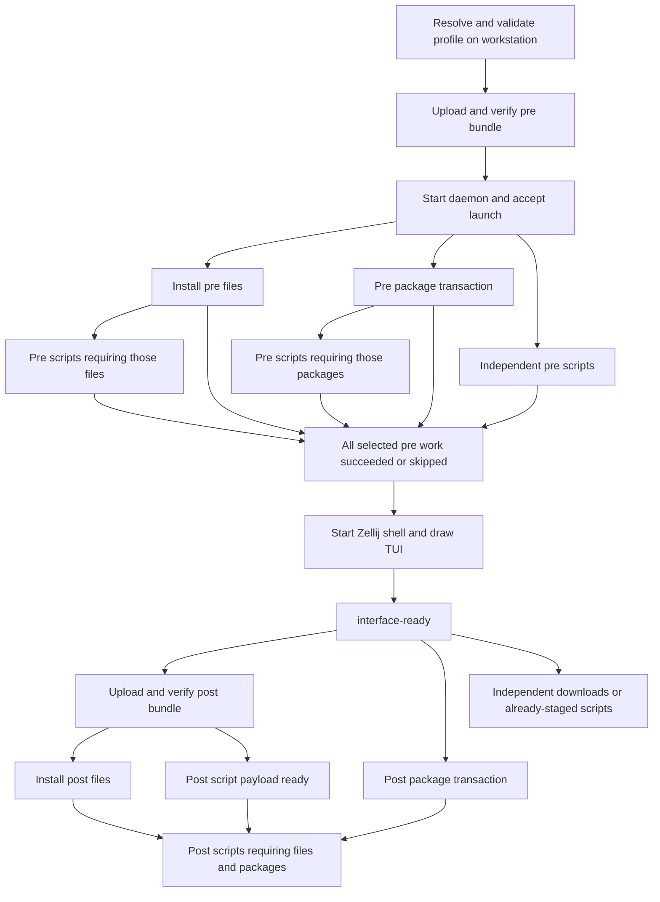

# Developing configurable launches

Status: developer guide draft, 2026-11-06. Configurable profiles and the
launch graph described here are planned, not implemented. The full
[launch design](../designs/LAUNCH_CONFIGURATION_DESIGN.md) records the
proposal and migration. Keep this guide aligned with each implementation
phase; document implemented commands and remaining proposals separately.

## Ownership and execution

The workstation resolves profiles, snapshots selected local sources, and
owns archive uploads and SSH grants. The Beam daemon runs package, file,
and script tasks through the existing executor. Zellij and the TUI are
clients of that daemon; neither owns task scheduling.

There is a pre phase that blocks session creation and a post phase that
waits for the initial shell and TUI to become ready. Within each phase,
dependencies and exclusive resources determine execution, not declaration
order or a global "packages, then scripts" sequence.



This is an example graph, not fixed waves. A task starts as soon as its
own prerequisites and resources allow it. An upload is a workstation job;
the Beam waits on its verified artifact readiness.

## Ordering contract

| Work | Required before it starts |
|---|---|
| File installation | Its archive's `artifact-ready:<bundle>` condition |
| Package batch | Its declared source/keyring preparation and package prerequisites |
| Any script | Its uploaded entrypoint/helper artifact and declared dependencies |
| Any post task | `interface-ready`, plus its own prerequisites |
| Session creation | Every selected pre task succeeded or skipped |
| Hook needing copied files | Successful installation of those named file entries |
| Hook needing installed packages | The package capabilities/batch that supplies them |

`phase = "pre"` means before the interface; it does not mean after the pre
package batch. A script without package dependencies may run concurrently
with apt. Package requirements declared by a task/template contribute to
the compiler's appropriate batch and create dependency edges. An explicit
`after = ["packages:post"]` waits for the entire post batch, including when
it skips because the packages already exist.

`after = ["files:data"]` waits for the data to be installed at its target,
not merely uploaded into staging. The `artifact-ready` condition certifies
complete receipt, digest verification, validated extraction, and publication
of staging; file installation is a separate graph node.

A resource such as `apt` or a toolchain destination enforces mutual
exclusion; it does not establish which task goes first or provide a
capability. Two independent downloads can overlap apt. Two apt mutations
serialize, and the cross-process package helper protects against other
bootstrap invocations. A script mutating apt must use that helper rather
than relying solely on a scheduler resource tag.

No pre task may depend on an explicitly post task. Required prerequisite
chains and shared script roots can be promoted into pre; `config explain`
must show why they block the interface.

## Example: configure files after packages

The configuration syntax below is proposed:

```toml
[tasks.configure]
phase = "post"
script = "./hooks/configure.sh"
script_root = "./hooks"
interpreter = ["bash"]
after = ["files:data", "packages:post"]
```

The compiler includes the local helper directory in the post archive and
adds artifact, file-installation, package-batch, and interface readiness
requirements. The hook runs when all four are satisfied. An unrelated
download starts after interface readiness without waiting for that hook.

Local source paths, including script roots, resolve against their declaring
profile even through inheritance. Execution, interpreter commands, checks,
and working directories are on the Beam. The default working directory is
the extracted entrypoint directory; use `BEAMS_SCRIPT_DIR` /
`BEAMS_SCRIPT_ROOT` to address helpers independently of a changed cwd.

Helper invocations belong to their caller's task and share its logs and
resource ownership. Use separate named tasks for independently scheduled
work or separate TUI status.

## Adding or changing a task

1. Define its parameters, desired-state probe or explicit retry policy,
   capabilities, package needs, and exclusive resources. Keep package
   preparation separate from long user-space downloads so apt is released.
2. Register it through the shared template path, expose it through task
   CLIs and TUI metadata, and preserve existing schema/coverage checks.
   Custom script templates use the same graph and progress contracts.
3. Declare file/script artifacts and dependency edges. Check inherited
   source origins and phase promotion in the compiled plan; do not depend
   on TOML entry order, an installer subprocess changing a pane's
   environment, or unrecorded state from another submission.
4. Emit progress and terminal state through the existing event path.
   Capture subprocess logs, propagate task/client identity and relay
   environment, and record completion only after success.
5. Verify the new behavior with compiler/executor fixtures or a disposable
   Beam where system state is involved. Cover failure blocking, resource
   conflicts, retry, and reconnect when relevant.
6. Update this guide, the relevant binary README, and the task's entry in
   `TODO.md` in the same change.

## Failures and recovery

A failed task blocks its dependents; unrelated tasks continue. A pre
failure prevents session creation. A post failure remains visible without
closing the shell. `check` runs again on retry; successful `on-change`
records include the script/helper content identity. Interrupted unchecked
scripts require explicit retry.

The launch ID makes acceptance retries refer to the same launch. A task
snapshot restores progress on UI reconnect. Upload retries restart the
archive in the first implementation, and only verified staging releases
artifact readiness. Inspecting a plan or explaining ordering runs offline
and never installs packages or invokes hooks.

## Documentation required during implementation

Deliver profile/schema and `config explain` examples with the compiler;
package/file/script extension guidance with execution primitives; readiness
and reconnect walkthroughs with the new launcher; and a complete annotated
development profile before switching defaults. Add actual command examples
as they land, including diagnosis of package waits, missing artifacts,
phase errors, and failed hooks.

Document a supported end-to-end example whose expected graph is also
checked by fixtures. Execution-order examples are part of acceptance,
so changes to implicit prerequisites must update both the guide and those
fixtures.
